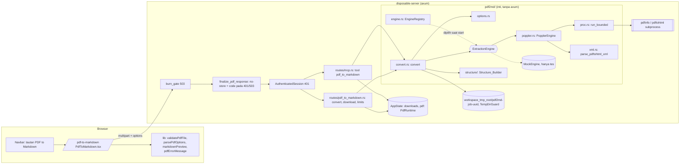

# Dokumen Desain

## Overview

Fitur ini menambahkan satu mini app mandiri **PDF to Markdown** ke Disposable Service Workspace: pengguna mengunggah PDF ber-text-layer, server mengekstrak teks dan struktur lewat subprocess `pdftohtml -xml` (poppler-utils), lalu heuristik Rust menyusun Markdown. Dokumen tidak pernah meninggalkan Workspace. Mini app memiliki halaman `/pdf-to-markdown`, tautan Navbar, tiga rute API, dan tool MCP `pdf_to_markdown`. Fitur ini bukan tab pada konverter Pandoc.

Cakupan Fase 1: heading, paragraf, daftar, blok kode, teks tebal/miring, dan penghapusan header/footer. Di luar cakupan: tabel, OCR, tata letak multi-kolom, ekstraksi gambar.

### Keputusan Desain Utama

| Keputusan | Alasan |
|---|---|
| Inti konversi berupa fungsi murni di modul baru `crates/server/src/pdf2md/` (tanpa axum), route dan MCP hanya adaptor tipis yang memanggil satu fungsi `convert()`. | Mengikuti pola `privacy/` + `routes/scrubber.rs`. REST dan MCP wajib menghasilkan `markdown`, `pages`, `headings`, `warnings` identik (Req 11.2), dan fungsi murni cocok untuk property-based testing. |
| `Structure_Builder` hanya mengenal **model dokumen perantara** (halaman, baris teks dengan ukuran font, flag tebal/miring/monospace, koordinat integer). Tidak ada import dari `poppler.rs` atau `xml.rs`. | Req 7.5 dan Req 16.3: penambahan mesin baru tidak boleh mengubah Structure_Builder, dan tes Structure_Builder harus berjalan tanpa poppler. |
| `trait ExtractionEngine` + `EngineRegistry` yang dipilih sekali saat start lewat `PDF_MD_ENGINE`. Nilai tak dikenal menghentikan proses sebelum port dibuka. | Req 7.2 sampai 7.4. |
| Semua koordinat dan ukuran font bertipe **integer** (`i32`/`u32`), perbandingan rasio memakai aritmetika integer (mis. `size * 100 >= body * 115`). | `pdftohtml -xml` menghasilkan atribut integer. Integer menghilangkan ketidakpastian float sehingga determinisme byte-per-byte (Req 6.6) dan tes properti stabil. |
| Subprocess dijalankan tanpa shell, argumen tetap, `HOME`/`XDG_*` di direktori sementara, grup proses sendiri, dimatikan lewat `killpg` pada drop, batas 30 detik kumulatif dan 100 MB keluaran. | Req 8.1 sampai 8.6, Req 12.3. `kill_on_drop` milik tokio hanya membunuh proses langsung, bukan turunan. |
| Penguraian XML memakai `quick-xml` (hanya untuk tokenisasi) dan fungsi `decode_entities` buatan sendiri yang bekerja **satu lintasan** pada teks mentah. | Menjamin entitas didekode tepat satu kali (Req 6.5) tanpa bergantung pada perilaku `unescape` yang berbeda antar versi `quick-xml`. |
| Ephemeral_Download memakai ulang `AppState.downloads`, ditambah `take_ephemeral_download_if` yang hanya menghapus entri bila `content_type` cocok. | Token milik scrubber/pandoc berada di map yang sama. Tanpa pemeriksaan tipe, token PDF/gambar bisa diambil lewat rute Markdown dan sebaliknya (Req 10.5). |
| Konfigurasi (`PDF_MD_ENGINE`, `PDF_MD_MAX_BYTES`, `PDF_MD_MAX_RESPONSE_BYTES`) dibaca satu kali di `main()` menjadi `PdfRuntime`, lalu disimpan di `AppState.pdf`. `AppState::new()` tetap tanpa argumen dan memakai nilai bawaan. | Puluhan tes yang ada memanggil `AppState::new()`. Tes baru menyuntikkan `PdfRuntime` tiruan lewat `AppState::with_pdf(...)`. |
| Pratinjau Markdown di frontend dirender oleh parser kecil buatan sendiri yang menghasilkan elemen React (node teks), tanpa `dangerouslySetInnerHTML` dan tanpa dependensi npm baru. | Req 13.18: HTML dan skrip pada hasil harus tampil sebagai teks. Keluaran Fase 1 hanya memakai subset sempit Markdown (heading, paragraf, daftar, kode, `---`, `*`/`**`/`***`, escape `\`). |

### Temuan dari Pembacaan Kode

- `routes/scrubber.rs` sudah memakai pola multipart + `DefaultBodyLimit` + `spawn_blocking` + `ApiResponse`. PDF_Converter mengikutinya, tetapi badan galat memakai bentuk baru `{success:false, code, message}` karena Req 2.11 mewajibkan field `code`.
- `AuthenticatedSession` menolak dengan `(401, "teks polos")` dan `burn_gate` menolak dengan `ApiResponse` tanpa `code`. Agar Req 2.11 dan Req 12.7 (header `no-store` pada semua respons termasuk 401/503) terpenuhi, rute PDF memakai middleware pasca-proses (lihat "Middleware `finalize_pdf_response`").
- `TempDirGuard { path }` (di `routes/pandoc.rs`) sudah RAII dan sinkron (`remove_dir_all` pada `Drop`). Direktori kerja dibuat di `workspace_tmp_root()` sehingga Burn Workspace ikut membersihkannya.
- `AppState.downloads` (`HashMap<String, EphemeralDownload>`) dibersihkan dari entri kedaluwarsa hanya saat `store_ephemeral_download` dipanggil dan tanpa menimpa buffer dengan nol. Req 10.9 menuntut penimpaan nol, jadi desain menambah `purge_expired_downloads()` dan sweeper latar belakang.
- Tool MCP baru sudah memakai `ToolOutcome::{Content, RpcError}` dan helper `args_object/req_str`. Desain menambah satu varian `RpcErrorData` (kode -32000 dengan field `data`) tanpa mengubah varian yang ada.
- `privacy/tests/helpers_http.rs` (`authed_app`, `send`, `post_multipart_file`) bersifat privat untuk modul `privacy::tests`. Desain memindahkan isinya ke `crates/server/src/test_support/http.rs` dan membuat berkas lama menjadi `pub(crate) use` ulang, sehingga tes lama tidak berubah.
- Di mesin pengembangan saat ini `pdftohtml`, `pdfinfo`, dan `typst` **tidak terpasang**, sedangkan `pandoc` dan `pdflatex` ada. Seluruh strategi tes dirancang agar `cargo test --workspace` tetap hijau tanpa poppler (lihat "Pengujian Tanpa Poppler").

## Architecture



### Alur Konversi (Sukses dan Galat)

```mermaid
sequenceDiagram
    participant C as Klien
    participant G as burn_gate + Auth
    participant H as handler (REST atau MCP)
    participant V as convert()
    participant T as TempDirGuard
    participant E as ExtractionEngine
    participant S as Structure_Builder

    C->>G: POST /api/apps/pdf-to-markdown (multipart)
    G-->>C: 503 (burning) atau 401 tanpa membaca body
    G->>H: lolos
    H->>H: baca part file (stop di Max_Bytes+1), part options (maks 4 KiB)
    H->>V: convert(runtime, bytes, options_raw)
    V->>V: 1) 413 ukuran, 2) 415 magic, 3) 400 options
    V->>T: buat pdf2md-job-uuid, tulis input.pdf, drop(bytes)
    V->>E: extract(path, dir, from, to, max_pages, deadline)
    E-->>V: IntermediateDoc atau EngineError
    V->>V: 422 bila tanpa teks; hitung warnings rentang halaman
    V->>S: build(doc, opts)
    S-->>V: BuildOutput(markdown, headings, removed, joins)
    V->>V: 422 no_text_layer bila markdown tanpa kata
    V-->>H: Conversion
    H->>H: download=true: simpan Ephemeral_Download
    H-->>C: 200 JSON + Cache-Control: no-store
    Note over T: drop guard: hapus direktori, juga bila future dibatalkan
```

### Penempatan Kode (mengikuti pola `privacy/`)

```
crates/common/src/lib.rs                      + PdfConversionResult, PdfLimits, PdfApiError, PdfMcpResult
crates/server/src/pdf2md/mod.rs               (baru) re-export, PdfRuntime
crates/server/src/pdf2md/config.rs            PdfConfig::from_env_with(), batas, deteksi Lambda
crates/server/src/pdf2md/error.rs             EngineError, ConvertError, ErrorCode (status + kode + prioritas)
crates/server/src/pdf2md/model.rs             IntermediateDoc, Page, TextLine, Span
crates/server/src/pdf2md/options.rs           ConversionOptions, parse_options()
crates/server/src/pdf2md/engine.rs            trait ExtractionEngine, ExtractRequest, EngineRegistry
crates/server/src/pdf2md/proc.rs              run_bounded(): subprocess tanpa shell, killpg, batas keluaran
crates/server/src/pdf2md/poppler.rs           PopplerEngine (pdfinfo + pdftohtml)
crates/server/src/pdf2md/xml.rs              parse_pdftohtml_xml(), decode_entities()
crates/server/src/pdf2md/structure/mod.rs     build(): pipeline + BuildOutput
crates/server/src/pdf2md/structure/rows.rs    urut baca dan penggabungan baris (row merge)
crates/server/src/pdf2md/structure/strip.rs   Repeated_Line dan Page_Number_Line
crates/server/src/pdf2md/structure/blocks.rs  klasifikasi baris, heading, paragraf, daftar, kode
crates/server/src/pdf2md/structure/inline.rs  gaya tebal/miring, escape, hyphenation
crates/server/src/pdf2md/structure/render.rs  Block -> teks Markdown
crates/server/src/pdf2md/convert.rs           convert(), shape_mcp_result()
crates/server/src/pdf2md/tests/               gen_*.rs, mock_engine.rs, prop_NN.rs, unit_*.rs
crates/server/src/routes/pdf_to_markdown.rs   (baru) 3 handler + router() + finalize_pdf_response
crates/server/src/routes/mod.rs               + pub mod pdf_to_markdown; .merge(...); layer finalize
crates/server/src/routes/mcp.rs               + tool pdf_to_markdown, varian RpcErrorData
crates/server/src/routes/burn.rs              burn_gate: tambah field "code" pada JSON 503
crates/server/src/state.rs                    + pdf: Arc<PdfRuntime>, with_pdf(), take_ephemeral_download_if(), purge_expired_downloads()
crates/server/src/main.rs                     + baca PdfRuntime sebelum bind, sweeper unduhan
crates/server/src/test_support/http.rs        (dipindah dari privacy/tests/helpers_http.rs)
crates/server/tests/pdf_to_markdown_startup.rs  (baru) tes proses anak untuk Req 7.4 dan 9.3
frontend/src/pages/pdf-to-markdown.astro      (baru)
frontend/src/components/PdfToMarkdown.tsx     (baru) + PdfToMarkdown.test.tsx
frontend/src/components/{AppRouter,Navbar,DashboardView}.tsx   diubah; Navbar.test.tsx baru
frontend/src/lib/{validatePdfFile,parsePdfOptions,markdownPreview,pdfErrorMessage,downloadText}.ts (+ .test.ts)
frontend/src/types/pdf.ts                     (baru) tipe DTO
deploy/Dockerfile, deploy/Dockerfile.lambda   + poppler-utils
deploy/docker-compose.yml                     + PDF_MD_ENGINE, PDF_MD_MAX_BYTES
README.md, AGENTS.md                          dokumentasi
```

Dependensi baru di `crates/server/Cargo.toml` (semua dipin dengan `=` seperti `lopdf` dan `regex` yang sudah ada, versi final dikunci saat implementasi):

- `quick-xml` (seri 0.37, fitur default). Dipakai hanya untuk tokenisasi; entitas didekode oleh `decode_entities`.
- `libc` (seri 0.2, `cfg(unix)`). Hanya untuk `killpg(pgid, SIGKILL)`. Tidak ada crate poppler: Req 8.9 (GPL hanya sebagai subprocess) dipenuhi dan dapat dites dengan membaca `Cargo.toml`.
- Dev: `proptest` dan `tempfile` sudah ada. Frontend memakai `vitest`, `fast-check`, dan Testing Library yang sudah terpasang.

## Components and Interfaces

### 1. Kontrak HTTP

| Rute | Metode | Body | Sukses | Galat |
|---|---|---|---|---|
| `/api/apps/pdf-to-markdown` | POST | multipart: part `file` (PDF), part `options` (JSON, opsional); query `download=true` opsional | 200 `PdfConversionResult` | 400, 401, 413, 415, 422, 500, 503, 504 |
| `/api/apps/pdf-to-markdown/download/:token` | GET | - | 200 `text/markdown; charset=utf-8`, `Content-Disposition: attachment; filename="document.md"` | 401, 404, 503 |
| `/api/apps/pdf-to-markdown/limits` | GET | - | 200 `PdfLimits {max_bytes, max_pages}` | 401, 503 |

Aturan lintas rute:

- Semua respons membawa `Cache-Control: no-store` (Req 10.12, 12.7).
- Metode lain pada tiga rute menghasilkan 405 dari router axum (Req 15.3). Tidak ada kode tambahan.
- `burn_gate` sudah menangani semua path `/api/apps/*`, sehingga tiga rute baru otomatis dijaga (Req 2.10, 15.4). `AuthenticatedSession` adalah argumen pertama setiap handler sehingga 401 terjadi sebelum body dibaca (Req 2.9).
- `DefaultBodyLimit::max(max_bytes + 65_536)` dipasang hanya pada rute POST (Req 9.5). Nilai diambil dari `state.pdf.config` saat `create_api_router(state)` dibangun, jadi tes dengan `max_bytes` kecil memakai router terpisah.

### 2. Konfigurasi dan `PdfRuntime`

```rust
pub const ABSOLUTE_MAX_BYTES: u64 = 26_214_400;     // 25 MiB, batas atas keras
pub const LAMBDA_DEFAULT_MAX_BYTES: u64 = 5_242_880; // 5 MiB
pub const MAX_PAGES: u32 = 300;
pub const MULTIPART_OVERHEAD: u64 = 65_536;
pub const SUBPROCESS_TIMEOUT: Duration = Duration::from_secs(30);
pub const MAX_OUTPUT_BYTES: usize = 104_857_600;     // 100 MiB
pub const DOWNLOAD_TTL_SECS: u64 = 300;
pub const LAMBDA_DEFAULT_MAX_RESPONSE_BYTES: u64 = 5_767_168; // 5,5 MiB (Max_Response_Bytes pada Lambda)

pub struct PdfConfig {
    pub max_bytes: u64,
    pub max_pages: u32,                 // 300 (tidak dapat dikonfigurasi)
    pub subprocess_timeout: Duration,   // 30 detik; hanya tes yang mengubahnya
    pub max_output_bytes: usize,        // 100 MiB; hanya tes yang mengubahnya
    pub max_response_bytes: Option<u64>, // Max_Response_Bytes dari PDF_MD_MAX_RESPONSE_BYTES; None = tanpa batas (server umum)
    pub warnings: Vec<String>,          // dicatat satu kali saat start (Req 9.4)
}

pub enum ConfigError { MaxBytesInvalid(String) }  // pesan menyebut PDF_MD_MAX_BYTES

impl PdfConfig {
    /// Murni: `get` adalah pembaca env yang dapat disuntik (tes tidak menyentuh env proses).
    pub fn from_env_with(get: &dyn Fn(&str) -> Option<String>) -> Result<PdfConfig, ConfigError>;
    pub fn body_limit(&self) -> usize { (self.max_bytes + MULTIPART_OVERHEAD) as usize }
}

pub struct PdfRuntime { pub config: PdfConfig, pub engine: Arc<dyn ExtractionEngine> }
impl PdfRuntime {
    pub fn from_env() -> Result<PdfRuntime, StartupError>;   // dipanggil main()
    pub fn defaults() -> PdfRuntime;                          // dipakai AppState::new()
}
```

Aturan `from_env_with` untuk `PDF_MD_MAX_BYTES` (Req 9.1 sampai 9.4):

```text
raw = get("PDF_MD_MAX_BYTES")
default = if is_lambda(get) { 5_242_880 } else { 26_214_400 }
if raw is None or raw == "" (persis kosong)       -> max_bytes = default
else if raw matches ^[0-9]+$ and parse::<u64>() ok and value >= 1:
       if value > 26_214_400: max_bytes = 26_214_400, warnings += "PDF_MD_MAX_BYTES melebihi 26214400; memakai 26214400"
       else: max_bytes = value
else -> Err(ConfigError::MaxBytesInvalid)         // "0", "-1", "1.5", "10MB", " 5", "99999999999999999999999"
```

`raw` yang hanya berisi spasi bukan "kosong" menurut Req 9.2, jadi ditolak (tidak cocok `^[0-9]+$`). Ini sengaja berbeda dari `PDF_MD_ENGINE` yang memperlakukan spasi sebagai tidak diatur (Req 7.3).

Deteksi Lambda (`is_lambda`): variabel `AWS_LAMBDA_FUNCTION_NAME` ada dan tidak kosong. Variabel ini selalu diisi platform Lambda, termasuk saat server berjalan di balik Lambda Web Adapter (`deploy/Dockerfile.lambda`). `Dockerfile.lambda` juga menulis `ENV PDF_MD_MAX_BYTES=5242880` secara eksplisit sebagai lapisan kedua, supaya batas tidak bergantung pada deteksi.

Batas body 5.242.880 + 65.536 = 5.308.416 byte, di bawah batas payload Function URL yang di-buffer (6 MB = 6.291.456 byte) dengan selisih sekitar 983 KB.

`PDF_MD_MAX_RESPONSE_BYTES` (Max_Response_Bytes, Req 9.10) dibaca dengan aturan pengurai yang sama seperti `PDF_MD_MAX_BYTES` (hanya `^[0-9]+$`, ≥ 1, muat `u64`; nilai tidak valid menghentikan start dengan pesan yang menyebut nama variabel) tetapi tanpa batas atas. Tidak diatur atau kosong: 5.767.168 byte (5,5 MiB) pada Lambda_Runtime (`is_lambda`) dan `None` (tanpa batas) pada server umum. Perilaku saat nilai tidak valid tidak dirinci requirements dan mengikuti pola Req 9.3. `convert()` menerapkan batas ini (lihat langkah 13).

`main()` memanggil `PdfRuntime::from_env()` **sebelum** `TcpListener::bind`. Pada `Err`, `main` menulis pesan ke stderr dan memanggil `std::process::exit(2)`. Port tidak pernah dibuka dan tidak ada mesin pengganti yang dipakai (Req 7.4, 9.3). Peringatan `config.warnings` dicatat lewat `tracing::warn!` tepat satu kali (nama variabel dan nilai batas saja, tanpa data pengguna).

### 3. Model Dokumen Perantara (`model.rs`)

```rust
pub struct IntermediateDoc {
    pub total_pages: u32,        // jumlah halaman dokumen sumber (bukan hanya yang dikonversi)
    pub first_page: u32,         // halaman efektif pertama (1-based)
    pub last_page: u32,          // halaman efektif terakhir (sudah dijepit ke total_pages)
    pub pages: Vec<Page>,        // tepat last_page - first_page + 1 elemen, berurutan
}

pub struct Page { pub number: u32, pub width: i32, pub height: i32, pub lines: Vec<TextLine> }

pub struct TextLine {
    pub spans: Vec<Span>,
    pub size: u32,       // ukuran font dominan (jumlah karakter terbanyak), satuan unit font mesin
    pub x: i32, pub y: i32, pub w: i32, pub h: i32,   // kiri, atas, lebar, tinggi
    pub mono: bool,      // true jika SEMUA span memakai font monospace (Monospace_Block)
}

pub struct Span { pub text: String, pub bold: bool, pub italic: bool, pub mono: bool, pub size: u32 }
```

Invarian model (diperiksa oleh generator tes dan `debug_assert!` di `build`):

- `TextLine.mono == spans.iter().all(|s| s.mono)` dan `spans` tidak kosong.
- Teks `Span` berisi karakter Unicode apa adanya (sudah didekode, tanpa entitas XML).
- `pages` terurut naik menurut `number`.

Mesin lain (mis. `pdftotext -layout`, MuPDF, OCR) cukup memetakan keluarannya ke struktur ini. Mesin yang tidak punya informasi gaya mengisi `bold=false`, `italic=false`, dan `size` seragam; Structure_Builder tetap menghasilkan paragraf.

### 4. Antarmuka Mesin dan Registry (`engine.rs`, `error.rs`)

```rust
#[axum::async_trait]
pub trait ExtractionEngine: Send + Sync {
    fn name(&self) -> &'static str;
    async fn extract(&self, req: &ExtractRequest<'_>) -> Result<IntermediateDoc, EngineError>;
}

pub struct ExtractRequest<'a> {
    pub pdf_path: &'a Path,        // di dalam direktori TempDirGuard milik permintaan
    pub work_dir: &'a Path,        // direktori yang sama; dipakai untuk HOME/XDG_*
    pub page_from: u32,            // >= 1 (sudah divalidasi)
    pub page_to: Option<u32>,      // None = halaman terakhir; >= page_from bila ada
    pub max_pages: u32,            // 300
    pub deadline: Deadline,        // sisa anggaran waktu, lihat proc.rs
    pub max_output_bytes: usize,
}

pub enum EngineError {
    Corrupt, Encrypted, NoTextLayer, Timeout, TooManyPages,   // lima dari delapan jenis pada Req 7.1
    Unavailable,       // executable tidak ada/tidak dapat dijalankan (Req 7.7)
    OutputTooLarge,    // keluaran > 100 MiB (Req 8.6)
    PageFromOutOfRange { total_pages: u32 },   // page_from > total_pages (Req 1.6)
}
```

Catatan kepatuhan terhadap Req 7.1: himpunan galat tetap terdiri dari delapan jenis (`corrupt`, `encrypted`, `no_text_layer`, `timeout`, `too_many_pages`, `engine_unavailable`, `output_too_large`, `page_from_out_of_range`), sama dengan enum di atas. Pemetaan: `engine_unavailable` ke HTTP 503, `output_too_large` ke 422, `page_from_out_of_range` ke 400. Kode galat pada badan JSON REST untuk kasus terakhir juga `page_from_out_of_range`.

`extract` memegang tiga tanggung jawab yang disebut Req 7.1 dan 1.5/1.6: menghitung `total_pages`, menjepit `page_to` ke `total_pages`, dan menolak `TooManyPages` bila `last - first + 1 > max_pages` **sebelum** menjalankan ekstraksi mahal. `IntermediateDoc.last_page` melaporkan nilai efektif sehingga `convert()` dapat membuat peringatan "page_to disesuaikan" tanpa mengetahui jumlah halaman dari sumber lain.

```rust
pub struct EngineRegistry { engines: BTreeMap<String, Arc<dyn ExtractionEngine>> }

impl EngineRegistry {
    pub fn with_builtin() -> Self;                                   // mendaftarkan "poppler"
    pub fn register(&mut self, name: &str, e: Arc<dyn ExtractionEngine>); // dipakai tes (MockEngine)
    pub fn valid_names(&self) -> Vec<String>;
    /// None, "", atau hanya spasi -> "poppler". Selain itu trim + lowercase lalu cari persis.
    pub fn select(&self, raw: Option<&str>) -> Result<Arc<dyn ExtractionEngine>, RegistryError>;
}
pub struct RegistryError { pub given: String, pub valid: Vec<String> }
// Display: "PDF_MD_ENGINE='<given>' tidak dikenal. Nilai valid: poppler"
```

Pesan galat registry memuat nilai yang diberikan operator (konfigurasi, bukan data pengguna dokumen) dan tidak memuat data dokumen.

### 5. Subprocess Terisolasi (`proc.rs`)

```rust
pub struct Deadline { end: Instant }          // anggaran kumulatif 30 detik per permintaan
impl Deadline { pub fn new(total: Duration) -> Self; pub fn remaining(&self) -> Duration; }

pub struct ProcSpec<'a> {
    pub program: &'a str,                     // "pdftohtml" atau "pdfinfo" (konstanta, bukan input pengguna)
    pub args: Vec<OsString>,                  // tersusun dari konstanta + angka + jalur buatan server
    pub work_dir: &'a Path,
    pub max_stdout: usize,
    pub max_stderr: usize,                    // 64 KiB, hanya untuk klasifikasi
}
pub struct ProcOutput { pub status_ok: bool, pub code: Option<i32>, pub stdout: Vec<u8>, pub stderr_snippet: Vec<u8> }
pub enum ProcError { NotFound, SpawnFailed, Timeout, OutputTooLarge, Io }

pub async fn run_bounded(spec: &ProcSpec<'_>, deadline: &Deadline) -> Result<ProcOutput, ProcError>;
```

Perilaku `run_bounded` (Req 8.1 sampai 8.8, 12.3):

1. `tokio::process::Command::new(program)` tanpa shell. `args` ditambahkan satu per satu (`.arg`), tidak ada penggabungan string perintah.
2. `env_clear()` lalu set hanya `PATH` (diwarisi dari proses), `HOME`, `XDG_CACHE_HOME`, `XDG_CONFIG_HOME`, `XDG_DATA_HOME` yang menunjuk ke subjalur di dalam `work_dir`, dan `LC_ALL=C.UTF-8`. Direktori subjalur dibuat di dalam guard.
3. `current_dir(work_dir)`, `stdin(Stdio::null())`, `stdout/stderr` piped, `kill_on_drop(true)`.
4. Unix: `cmd.as_std_mut().process_group(0)` (via `std::os::unix::process::CommandExt`) agar anak dan semua turunannya berada di grup proses baru. Objek `PgidGuard(pid)` dibuat setelah `spawn` dan memanggil `libc::killpg(pid, SIGKILL)` pada `Drop`. Karena guard hidup di dalam future, pembatalan future (klien memutus koneksi, atau handler di-drop) otomatis membunuh seluruh grup dalam hitungan milidetik (Req 8.5, 12.3). Non-Unix: `run_bounded` mengembalikan `ProcError::NotFound` (platform tidak didukung).
5. Tiga tugas dijalankan bersamaan lewat `tokio::join!` di dalam `tokio::time::timeout(deadline.remaining(), ...)`: baca stdout dengan batas `max_stdout`, baca stderr dengan batas `max_stderr` (sisa dibuang agar pipa tidak penuh), dan `child.wait()`.
6. Bila pembacaan stdout melewati `max_stdout`, `PgidGuard` dilepas lewat `kill_now()`, pembacaan dihentikan, hasil `OutputTooLarge`, tidak ada keluaran parsial yang dikembalikan.
7. Bila `timeout` habis: `kill_now()`, `child.wait()` untuk memanen proses, hasil `Timeout`. Total waktu sampai grup mati < 1 detik (Req 2.8, 8.5).
8. `stderr_snippet` tidak pernah dilog. Hanya fungsi `classify_stderr` (di `poppler.rs`) yang membacanya di memori (Req 8.8).

Anggaran waktu kumulatif: satu `Deadline` 30 detik dipakai bersama oleh `pdfinfo` dan `pdftohtml` dalam satu permintaan. Dengan itu total waktu respons ≤ 30 detik + pemrosesan heuristik, memenuhi batas 35 detik pada Req 1.9. Alternatif "30 detik per subprocess" dapat menghasilkan 60 detik dan ditolak.

### 6. `PopplerEngine` (`poppler.rs`)

```rust
pub struct PopplerEngine { pdftohtml: String, pdfinfo: String }   // bawaan "pdftohtml" dan "pdfinfo"

impl ExtractionEngine for PopplerEngine {
    async fn extract(&self, r: &ExtractRequest) -> Result<IntermediateDoc, EngineError> {
        // 1. jumlah halaman dan klasifikasi awal
        let info = run_bounded(pdfinfo [pdf_path], ...).map_err(map_proc)?;       // argumen: hanya jalur file
        if !info.status_ok { return Err(classify_stderr(&info.stderr_snippet)); }  // Encrypted atau Corrupt
        let total = parse_pages_line(&info.stdout).ok_or(EngineError::Corrupt)?;   // baris "Pages:   N"
        // 2. rentang efektif
        if r.page_from > total { return Err(PageFromOutOfRange { total_pages: total }); }
        let last = min(r.page_to.unwrap_or(total), total);
        if last - r.page_from + 1 > r.max_pages { return Err(TooManyPages); }
        // 3. ekstraksi
        let out = run_bounded(pdftohtml ["-xml","-i","-q","-stdout","-f",from,"-l",last, pdf_path], ...)?;
        if !out.status_ok { return Err(classify_stderr(&out.stderr_snippet)); }
        let mut doc = parse_pdftohtml_xml(&out.stdout).map_err(|_| EngineError::Corrupt)?;
        doc.total_pages = total; doc.first_page = r.page_from; doc.last_page = last;
        Ok(doc)
    }
}
```

Argumen `pdftohtml` persis: `-xml -i -q -stdout -f <from> -l <last> <pdf_path>`. `<from>` dan `<last>` adalah hasil `u32::to_string()` dari angka yang sudah divalidasi, `<pdf_path>` adalah `work_dir/input.pdf` yang dibuat server. Tidak ada argumen yang berasal dari nama file atau isi permintaan (Req 8.1, 8.2, 8.3).

`pdfinfo` ikut dari paket `poppler-utils` yang sama dan dipakai hanya untuk jumlah halaman dan klasifikasi awal sandi/korup. Req 8.1 mengizinkan `pdfinfo` dengan argumen tetap hanya berupa jalur berkas masukan buatan server, dengan isolasi yang sama seperti `pdftohtml` dan anggaran 30 detik bersama. Alternatif yang dipertimbangkan:

| Alternatif | Kelebihan | Kekurangan |
|---|---|---|
| `pdfinfo` (dipilih) | Satu paket yang sama, tanpa dependensi baru, jumlah halaman dan status sandi dari parser yang sama dengan `pdftohtml`. | Satu subprocess tambahan (puluhan ms). |
| `lopdf::Document::load_mem(...).get_pages().len()` | Tanpa subprocess. | Parser berbeda dari poppler, PDF yang terenkripsi hanya pemilik-sandi dilaporkan terenkripsi padahal poppler dapat membacanya, PDF dengan xref rusak yang dapat dipulihkan poppler akan ditolak. |
| Ekstrak semua halaman lalu potong di Rust | Satu subprocess. | Melanggar maksud `-f`/`-l` pada Req 8.2 dan menaikkan biaya untuk dokumen besar. |

`classify_stderr(snippet) -> EngineError` (Req 8.7): bila snippet (tanpa membedakan huruf besar/kecil) memuat `incorrect password` atau `password` bersama `encrypted` maka `Encrypted`; selainnya `Corrupt` (termasuk pola "Syntax Error", "May not be a PDF file", dan setiap pola tak dikenal). Fungsi ini murni dan dites dengan potongan stderr tetap.

`map_proc`: `NotFound|SpawnFailed -> Unavailable`, `Timeout -> Timeout`, `OutputTooLarge -> OutputTooLarge`, `Io -> Corrupt` (galat I/O pipa dianggap tidak dapat dipulihkan; pesan generik).

### 7. Penguraian XML `pdftohtml -xml` (`xml.rs`)

Bentuk keluaran yang diharapkan (berdasarkan format `pdftohtml -xml`):

```xml
<?xml version="1.0" encoding="UTF-8"?>
<!DOCTYPE pdf2xml SYSTEM "pdf2xml.dtd">
<pdf2xml producer="poppler" version="22.12.0">
<page number="1" position="absolute" top="0" left="0" height="1188" width="918">
  <fontspec id="0" size="14" family="Times" color="#000000"/>
  <fontspec id="1" size="11" family="Courier" color="#000000"/>
  <text top="100" left="80" width="300" height="16" font="0"><b>Judul</b></text>
  <text top="130" left="80" width="400" height="14" font="0">Teks dengan &amp; entitas &lt;tag&gt;</text>
</page>
</pdf2xml>
```

```rust
pub fn parse_pdftohtml_xml(xml: &[u8]) -> Result<IntermediateDoc, XmlError>;
pub fn decode_entities(raw: &str) -> String;     // satu lintasan
pub enum XmlError { Malformed, NoPages }
```

Algoritma:

1. `quick_xml::Reader::from_reader(xml)` dengan `trim_text(false)` dan `check_end_names(false)` (pdftohtml kadang menghasilkan pasangan tag `<b><i>` yang urutan penutupnya tidak rapi). Proses event: `Start/Empty/End/Text/CData/Decl/DocType`. DOCTYPE dan komentar dilewati. Tidak ada resolusi entitas eksternal: `quick-xml` tidak mengikuti DTD sehingga XXE tidak relevan.
2. `<fontspec id size family>` mengisi `fonts: BTreeMap<u32, FontInfo{size, mono, bold, italic}>`. `FontInfo` dihitung dari `family`: `mono` bila cocok regex tak sensitif huruf `courier|consolas|menlo|monaco|mono|cmtt|typewriter|lucida console|inconsolata`, `bold` bila `bold|black|heavy|semibold`, `italic` bila `italic|oblique`. Daftar bertahan sesuai Req Glossary (Courier, Consolas, Menlo, Monaco, "Mono") ditambah `cmtt` (font `\texttt` LaTeX) dan beberapa nama umum.
3. `<page number height width>` memulai `Page`. `<text top left width height font>` memulai `TextLine` dengan `size = fonts[font].size`.
4. Isi `<text>` adalah campuran teks dan tag inline `<b>`, `<i>`, `<a href>`. Penggunaan tumpukan gaya: `b_depth`, `i_depth`. Setiap event `Text` menghasilkan `Span{text: decode_entities(raw), bold: b_depth>0 || font.bold, italic: i_depth>0 || font.italic, mono: font.mono, size}`. Tag lain (`<a>`, `<u>`) hanya diabaikan, teksnya tetap dibaca.
5. **Entitas didekode tepat satu kali**: `quick-xml` tidak dipanggil untuk `unescape`; teks mentah (`BytesText::as_ref()` sebagai `&[u8]` lalu `from_utf8`) diteruskan ke `decode_entities`, satu-satunya tempat entitas didekode:

```text
fn decode_entities(raw: &str) -> String:
    out = String::with_capacity(raw.len()); i = 0
    while i < raw.len():
        if raw[i] != '&': out.push(raw[i]); i += 1; continue
        j = index of ';' in raw[i+1 ..= i+10] (maksimum 10 karakter)   // batas agar O(n)
        if none: out.push('&'); i += 1; continue                       // '&' liar tetap literal
        name = raw[i+1 .. j]
        match name:
            "amp" => '&', "lt" => '<', "gt" => '>', "quot" => '"', "apos" => '\''
            "#" + digits       => char::from_u32(dec) or U+FFFD
            "#x"/"#X" + hex    => char::from_u32(hex) or U+FFFD       // 0, surrogat, > 0x10FFFF -> U+FFFD
            other              => out.push_str(raw[i ..= j])           // entitas tak dikenal tetap literal
        i = j + 1                                                        // melompat melewati yang sudah diproses
```

   Karena `i` selalu melompat melewati entitas yang telah diganti dan keluaran tidak pernah dibaca ulang, `&amp;lt;` menjadi `&lt;` (bukan `<`), sesuai Req 6.5. Tipe dipisahkan: fungsi publik hanya `decode_entities(&str) -> String`, dan `Span.text` selalu hasil fungsi itu. Tidak ada jalur kode lain yang memanggil dekode.
6. Karakter kontrol ilegal XML 1.0 yang kadang dipancarkan pdftohtml tidak membuat `quick-xml` gagal (parser tidak memvalidasi). `decode_entities` menggantikan referensi numerik ke kontrol C0 (kecuali `\t`, `\n`, `\r`) dengan U+FFFD.
7. Baris dengan teks kosong atau hanya spasi dibuang. Teks `Span` tidak di-trim; spasi di tepi dipertahankan sampai tahap penggabungan baris.
8. Galat: XML tidak terbentuk (kesalahan tokenisasi `quick-xml`) atau tidak ada `<page>` sama sekali -> `XmlError` -> `EngineError::Corrupt`. Halaman tanpa `<text>` valid (halaman kosong).

Pilihan `quick-xml` dibanding `roxmltree`/`xml-rs`: `quick-xml` adalah pull-parser berbasis aliran tanpa alokasi pohon, penting karena keluaran bisa mendekati 100 MiB; `roxmltree` memuat seluruh dokumen sebagai pohon (memori beberapa kali lipat ukuran masukan) dan ditolak untuk batas ini.

### 8. Opsi Konversi (`options.rs`)

```rust
pub struct ConversionOptions {
    pub page_from: u32,                // bawaan 1
    pub page_to: Option<u32>,          // bawaan None = halaman terakhir
    pub page_breaks: bool,             // bawaan false
    pub strip_headers_footers: bool,   // bawaan true
}
pub struct OptionsError { pub field: String, pub reason: &'static str }  // field = nama field atau "options" (JSON tidak valid)

pub fn parse_options(raw: Option<&[u8]>) -> Result<ConversionOptions, OptionsError>;
```

Penguraian manual atas `serde_json::Value` (bukan `#[derive(Deserialize)]` + `deny_unknown_fields`), agar pesan galat selalu menyebut nama field secara deterministik (Req 1.4):

1. `raw == None` atau panjang 0 -> semua bawaan. `raw.len() > 4096` -> `OptionsError{field:"options", reason:"terlalu besar"}`.
2. `serde_json::from_slice::<Value>` gagal -> `field:"options"`, `reason:"JSON tidak valid"`. Hasil bukan objek -> `field:"options"`.
3. Kunci yang bukan salah satu dari `page_from|page_to|page_breaks|strip_headers_footers` -> `field:<kunci>`, `reason:"field tidak dikenal"`. Kunci diurutkan alfabet saat diiterasi agar field yang dilaporkan deterministik.
4. `page_from`/`page_to`: harus `Number` dengan `is_u64()` dan nilai ≥ 1; `null`, string, float (`1.0`), negatif, atau 0 ditolak. Nilai di atas `u32::MAX` dijepit ke `u32::MAX` (tetap valid, lalu dijepit lagi ke jumlah halaman oleh mesin).
5. `page_breaks`/`strip_headers_footers`: harus `Bool`.
6. Setelah semua field valid: `page_from > page_to` -> `field:"page_from"`, `reason:"tidak boleh lebih besar dari page_to"`.

`parse_options` tidak mengetahui jumlah halaman dokumen; pemeriksaan terhadap jumlah halaman berada di mesin (`extract`) dan `convert()` (lihat Aturan Rentang Halaman).

### 9. Orkestrasi `convert()` (`convert.rs`)

```rust
pub struct ConvertInput { pub file: Vec<u8>, pub options_raw: Option<Vec<u8>>, pub extra_file_parts: usize }
pub struct Conversion { pub markdown: String, pub pages: u32, pub headings: u32, pub warnings: Vec<String> }

pub async fn convert(rt: &PdfRuntime, input: ConvertInput) -> Result<Conversion, ConvertError>;
```

Urutan langkah dalam `convert` mengikuti prioritas Req 2.12 (**413, 415, 400, 422, 504**; 401 dan 503 sudah ditangani sebelum handler):

```text
1. if file.len() as u64 > rt.config.max_bytes         -> Err(FileTooLarge)               // 413
2. if !file.starts_with(b"%PDF-")                      -> Err(NotAPdf)                    // 415 (juga untuk 0 byte)
3. options = parse_options(options_raw)?               -> Err(BadOptions{field,reason})   // 400
4. guard = TempDirGuard{ workspace_tmp_root()/pdf2md-job-<uuid> }; create_dir_all(...)
       -> on io error: Err(Internal)                   // 500, guard menghapus apa yang sempat dibuat
5. write guard/input.pdf  (nama tetap, bukan nama unggahan); drop(file) setelah tulis
       -> on io error: Err(Internal)
6. deadline = Deadline::new(rt.config.subprocess_timeout)
7. doc = rt.engine.extract(ExtractRequest{ ..., page_from, page_to, max_pages:300, deadline }).await.map_err(from_engine)?
       from_engine: Corrupt->CorruptPdf(422) Encrypted->EncryptedPdf(422) NoTextLayer->NoTextLayer(422)
                    Timeout->Timeout(504) TooManyPages->TooManyPages(422) Unavailable->EngineUnavailable(503)
                    OutputTooLarge->OutputTooLarge(422) PageFromOutOfRange{n}->PageFromOutOfRange(400, pesan memuat n)
8. if doc has no non-whitespace char                   -> Err(NoTextLayer)                // 422
9. warnings = []
   if extra_file_parts > 0: warnings.push("File tambahan diabaikan; hanya file pertama diproses.")
   if let Some(req_to) = options.page_to { if req_to > doc.last_page: warnings.push(format!("page_to disesuaikan menjadi {}", doc.last_page)) }
10. out = structure::build(&doc, &BuildOptions{ page_breaks, strip_headers_footers })
11. if out.word_count == 0                                -> Err(NoTextLayer)
12. warnings += out.warnings    // satu entri "N baris header/footer dihapus" bila N >= 1
13. result = Conversion{ markdown: out.markdown, pages: doc.pages.len() as u32, headings: out.headings, warnings }
    if let Some(cap) = rt.config.max_response_bytes {
        if serde_json::to_vec(&PdfConversionResult::from(&result)).len() as u64 > cap
                                                       -> Err(OutputTooLarge)             // 422 output_too_large (Req 9.10); pesan menganjurkan page_from/page_to
    }                                                  // diperiksa sebelum Ephemeral_Download dibuat; tanpa body terpotong
    Ok(result)
```

Urutan 413/415/400 terhadap pembacaan multipart: handler membaca seluruh multipart lebih dulu (dengan penghentian dini di `max_bytes + 1` untuk part `file`), baru memanggil `convert`. Jika part `file` melewati `max_bytes`, handler segera mengembalikan 413 tanpa membaca sisa body, yang konsisten dengan prioritas karena 413 lebih tinggi daripada 415 dan 400.

`convert` dijalankan di dalam `spawn_blocking` hanya untuk tahap `structure::build` (CPU-bound, batas 5 detik pada Req 1.9). Tahap `extract` berjalan async.

#### Aturan Rentang Halaman

Fungsi murni `resolve_range(from: u32, to: Option<u32>, total: u32, max_pages: u32) -> Result<(u32, u32, Option<Warning>), RangeError>` dipakai oleh `PopplerEngine`, `MockEngine`, dan dites sebagai properti:

```text
if from > total                      -> Err(FromBeyondTotal(total))            // Req 1.6 -> HTTP 400
last = min(to.unwrap_or(total), total)
warn = to.is_some() and to > total   // Req 1.5: tepat satu peringatan
if last - from + 1 > max_pages       -> Err(TooManyPages)                      // Req 2.7: 300 diterima, 301 ditolak
Ok((from, last, warn))
```

`pages` pada hasil sama dengan `last - from + 1` (Req 5.7).

#### Pembentukan hasil MCP

```rust
pub const MCP_INLINE_MAX_CHARS: usize = 100_000;
pub const MCP_PREVIEW_CHARS: usize = 2_000;
pub fn shape_mcp_result(c: &Conversion, download_url: impl FnOnce() -> Option<String>) -> PdfMcpResult;
```

`truncated = c.markdown.chars().count() > 100_000` (karakter Unicode, bukan byte). Jika true: `preview` = 2.000 `char` pertama, `download_url` terisi, `markdown` None. Jika false: `markdown` penuh, tanpa `download_url`, `truncated=false`. Penyimpanan Ephemeral_Download dilakukan oleh pemanggil hanya pada cabang true.

### 10. Structure_Builder (`structure/`)

```rust
pub struct BuildOptions { pub page_breaks: bool, pub strip_headers_footers: bool }
pub struct BuildOutput {
    pub markdown: String,
    pub headings: u32,
    pub warnings: Vec<String>,     // paling banyak satu entri penghapusan (Req 5.4)
    pub removed_lines: u32,
    pub hyphen_joins: u32,         // dipakai Req 6.2 dan tes
    pub word_count: u32,
}
pub fn build(doc: &IntermediateDoc, opts: &BuildOptions) -> BuildOutput;   // murni, deterministik
```

Pipeline (tiap tahap berupa fungsi murni sehingga dapat dites sendiri):

```text
build(doc, opts):
  pages = doc.pages.map(rows::order_and_merge)                    // 10.1
  removed = if opts.strip { strip::strip(&mut pages) } else { 0 } // 10.2
  body = blocks::body_font_size(&pages)                           // 10.3
  levels = blocks::heading_levels(&pages, body)                   // 10.4
  per_page_blocks = pages.map(|p| blocks::classify_and_group(p, body, &levels))   // 10.5
  stream = blocks::join_pages(per_page_blocks, opts.page_breaks)  // 10.6
  md = render::render(stream)                                     // 10.7
```

#### 10.1 Urutan baca dan penggabungan baris (`rows.rs`)

```rust
pub fn order_and_merge(page: Page) -> Page;
```

1. Urutkan `lines` dengan kunci `(y, x)` stabil (Req 6.3: atas ke bawah, lalu kiri ke kanan).
2. Gabungkan baris yang berada pada **baris visual** yang sama. Dua baris `a` (lebih kiri) dan `b` bergabung bila `|(a.y + a.h) - (b.y + b.h)| <= max(1, min(a.h, b.h) / 4)` (tepi bawah sejajar, proksi garis dasar) dan `b.x >= a.x`. Penggabungan menyisipkan spasi di antara dua `Span` bila celah horizontal `g = b.x - (a.x + a.w)` memenuhi `g > 0 && g * 5 >= max(a.h, b.h)` (≥ 0,2 × tinggi baris, kira-kira lebar spasi) dan tidak ada spasi di tepi teks tersebut. Jika tidak, teks langsung disambung (mis. tanda kurung `(` yang menempel).
3. Hasil gabungan memiliki `x = a.x`, `w` mencakup keduanya, `y/h` dari gabungan (min `y`, max tepi bawah), `size` = ukuran dari `Span` dengan jumlah karakter terbanyak (seri: ukuran lebih besar), `mono = spans.all(mono)`.

Penggabungan ini penting karena `pdftohtml` memecah satu baris menjadi beberapa elemen `<text>` saat font berganti (mis. kode inline di tengah kalimat) dan memisahkan penanda bullet dari teks item. Tanpa langkah ini kode inline akan menjadi blok kode terpisah. Urutan kata tidak berubah oleh penggabungan (hanya spasi disisipkan), sehingga Req 6.1 terjaga.

#### 10.2 Penghapusan header, footer, dan nomor halaman (`strip.rs`)

```rust
pub fn strip(pages: &mut [Page]) -> u32;          // jumlah baris yang dihapus
fn zone(line: &TextLine, page_h: i32) -> Option<Zone>;   // Top bila line.y * 10 < page_h; Bottom bila (line.y + line.h) * 10 > page_h * 9
pub fn normalize(text: &str) -> String;                   // setiap deret digit -> '#', spasi diringkas, trim
pub fn is_page_number_line(text: &str) -> bool;
```

- `Page_Number_Line` (Req 5.2, tanpa memandang jumlah halaman): teks (trim) cocok salah satu: `^\d{1,6}$`, bilangan Romawi valid (huruf `ivxlcdm` seluruhnya huruf kecil atau seluruhnya kapital, panjang 1 sampai 8, dan lolos pemeriksaan tata bahasa Romawi pada fungsi `is_roman`), `^(?i)(page|halaman)\s+\d{1,6}$`, atau `^\d{1,6}\s+(?i:of)\s+\d{1,6}$`. Hanya baris yang berada di zona atas atau bawah yang dipertimbangkan.
- `Repeated_Line` (Req 5.1): hanya bila `pages.len() >= 3`. Untuk setiap baris di zona atas/bawah hitung kunci `(zone, normalize(text))`. Hitung jumlah **halaman berbeda** per kunci. Kunci menjadi Repeated bila `halaman >= 3 && halaman * 2 >= pages.len()` (≥ 50%). Semua baris dengan kunci itu di zona yang sama dihapus. Karena normalisasi mengganti digit, "Laporan 2024 - 3" dan "Laporan 2024 - 4" dianggap sama (nomor halaman di dalam header). Konsekuensi: header yang berisi angka berbeda per halaman tetap terhapus; header yang berubah per bab (kata berbeda) tidak.
- Baris di luar zona atas/bawah tidak pernah dihapus meskipun teksnya sama dengan Repeated_Line (Req 5.8).
- `removed` menghitung jumlah baris yang dihapus (bukan jumlah kunci). Bila `removed >= 1`, `build` menambah satu entri `"{N} baris header/footer dihapus"` ke `warnings`; isi baris tidak pernah masuk pesan (Req 5.4). Bila `strip_headers_footers=false`, fungsi tidak dipanggil dan tidak ada peringatan (Req 5.3).
- Perhitungan memakai hanya halaman dalam `doc.pages` yang sudah dibatasi `page_from..page_to` (Req 5.7).

#### 10.3 Ukuran font isi (Body_Font_Size)

```rust
pub fn body_font_size(pages: &[Page]) -> u32;
```

Hitung `BTreeMap<u32 size, usize chars>` dengan menjumlahkan jumlah `char` non-spasi per `Span` (bukan per baris, agar baris campuran adil). `body` = ukuran dengan karakter terbanyak; seri dipecahkan dengan ukuran lebih kecil (deterministik; teks isi hampir selalu lebih kecil daripada heading). Dihitung **setelah** langkah strip agar header dengan font besar tidak memengaruhi hasil. Dokumen tanpa karakter: `body = 0` (tidak terjangkau karena `convert` menolak dokumen tanpa teks).

#### 10.4 Level heading

```rust
pub const HEADING_NUM: u32 = 115; pub const HEADING_DEN: u32 = 100;
pub fn is_heading_size(size: u32, body: u32) -> bool { size * 100 >= body * 115 }
pub fn heading_levels(pages: &[Page], body: u32) -> BTreeMap<u32, u8>;   // ukuran -> level 1..=6
```

1. `sizes` = himpunan ukuran font **dari baris non-monospace** yang memenuhi `is_heading_size`, diurutkan menurun.
2. Level = indeks + 1 untuk enam ukuran terbesar; setiap ukuran yang lebih kecil dari enam terbesar mendapat level 6 (Req 3.1).
3. Monoton (Req 3.2): ukuran lebih besar -> level ≤ ukuran lebih kecil; ukuran sama -> level sama (peta dari ukuran).
4. Tanpa ukuran di atas ambang -> peta kosong, `headings = 0` (Req 3.9).

Baris monospace tidak pernah menjadi heading (Req 4.10 menegaskan prioritas kode). Dokumen yang seluruhnya berukuran seragam tidak menghasilkan heading; heading yang hanya dibedakan oleh huruf tebal (tanpa ukuran lebih besar) di luar cakupan Fase 1 (lihat Risiko).

#### 10.5 Klasifikasi dan pengelompokan blok (`blocks.rs`)

```rust
pub enum Block {
    Heading { level: u8, spans: Vec<Span> },
    Paragraph { spans: Vec<Span>, last_line_ends_sentence: bool, first_size: u32 },
    ListItem { ordered: Option<u32>, level: u8, spans: Vec<Span> },
    Code { lines: Vec<CodeLine> },                 // CodeLine { indent: usize, text: String }
}
enum LineKind { Code, Heading(u8), Bullet{ rest_start }, Ordered{ n, rest_start }, Text }
```

Klasifikasi per baris, **urutan prioritas tetap** (Req 4.10: kode menang atas penanda daftar):

```text
classify(line):
  if line.mono                                   -> Code
  else if is_heading_size(line.size, body)       -> Heading(levels[line.size])
  else if text matches ^(•|◦|▪|-|\*)[ ]+        -> Bullet      (penanda diikuti >= 1 spasi, Req 4.1)
  else if text matches ^(\d{1,9})([.)])[ ]+      -> Ordered{n}  (Req 4.2)
  else                                            -> Text
```

Pengelompokan berurutan (mesin keadaan satu lintasan atas baris yang sudah terurut), dengan `pitch = next.y - prev.y` dan aturan "dekat" `near(prev, next) := 2 * pitch <= 3 * prev.h` (jarak ≤ 1,5 × tinggi baris, Req 3.3, 3.4, 4.5):

- `Heading`: baris berurutan dengan `size` sama dan `near` digabung menjadi satu heading (spasi pemisah); heading baru bila ukuran atau kedekatan berbeda.
- `Text`: bila baris sebelumnya adalah `Text` dengan `size` sama dan `near` -> lanjutkan paragraf; bila tidak -> paragraf baru (Req 3.3, 3.4). Saat menyambung dua baris dalam satu paragraf berlaku aturan hyphenation (10.8).
- `Bullet`/`Ordered`: membuat `ListItem`. Teks item = teks setelah penanda (tanpa spasi awal tambahan). `Ordered` mengeluarkan `N. ` dengan N angka sumber, penanda `)` menjadi `.`.
- Lanjutan daftar (Req 4.5): baris `Text` yang langsung mengikuti `ListItem` dengan `size` sama dan `near` menempel ke item itu (spasi pemisah, hyphenation berlaku), bukan paragraf baru.
- `Code`: baris `Code` berurutan masuk satu blok. Bila jarak vertikal antar dua baris kode `> 1,5 × tinggi`, satu baris kosong disisipkan di dalam blok (maksimum satu, agar Req 3.10 terjaga). Blok kode terpisah dari blok kode lain hanya jika diselingi baris non-kode (Req 4.7).

**Nesting daftar (Req 4.3, 4.4)**: tumpukan indentasi `stack: Vec<i32>` (nilai `x` item), di-reset oleh setiap blok non-daftar. Toleransi `tol = max(2, line.size as i32 / 2)`.

```text
level_for(x, stack):
  if stack.is_empty():                       stack = [x]; return 1
  if x > top(stack) + tol:                   stack.push(x); return min(stack.len(), 4)      // lebih dalam satu tingkat
  if |x - top(stack)| <= tol:                return min(stack.len(), 4)                     // tingkat sama
  while stack.len() > 1 && top(stack) > x + tol: stack.pop()                                // lebih dangkal
  if |x - top(stack)| > tol && x < top(stack):  stack = [x]; return 1                        // lebih kiri dari semua
  return min(stack.len(), 4)                                                                  // tingkat terdekat dengan indentasi <= x
```

Indentasi keluaran: `2 * (level - 1)` spasi sebelum `- ` atau `N. `. Kedalaman lebih dari 4 diposisikan di tingkat 4, teks tetap utuh (Req 4.4); `stack` tetap tumbuh agar tingkat balik yang benar saat indentasi mengecil.

**Blok kode dan indentasi relatif**: untuk blok `Code`, `x_min = min(line.x)`, `unit = max(1, sum(line.w) / sum(char_count(line.text)))` (lebar rata-rata per karakter monospace), `indent_i = round((x_i - x_min) / unit)`. Teks tiap baris di-`trim` kiri/kanan lalu diawali `indent_i` spasi. Penghapusan spasi awal dari teks sumber menghindari penghitungan ganda karena `x` sudah mencerminkan spasi awal (verifikasi pada spike awal: lihat Risiko).

#### 10.6 Antarmuka antar halaman (`join_pages`)

```rust
pub fn join_pages(pages: Vec<Vec<Block>>, page_breaks: bool) -> Vec<Item>;   // Item = Block | PageBreak
```

- `page_breaks=true`: sisipkan tepat satu `PageBreak` di antara setiap dua halaman yang dikonversi, termasuk bila halaman kosong; jumlah pemisah = `pages - 1` (Req 5.5).
- `page_breaks=false` (Req 5.6): tidak ada pemisah. Bila blok terakhir halaman `p` adalah `Paragraph` yang baris terakhirnya **tidak** berakhir `.`, `!`, `?`, atau `:` dan blok pertama halaman `p+1` adalah `Paragraph`, keduanya digabung dengan satu spasi (hyphenation berlaku). Heading, `ListItem`, dan `Code` tidak pernah digabung dengan paragraf. Dua blok `Code` yang bersebelahan lintas halaman digabung menjadi satu blok (konsisten dengan Req 4.6; ditandai pertanyaan terbuka nomor 2).

#### 10.7 Inline, escape, dan render (`inline.rs`, `render.rs`)

```rust
pub fn escape_markdown(s: &str, at_line_start: bool) -> String;
pub fn unescape_markdown(s: &str) -> String;                 // fungsi uji: kebalikan escape_markdown
pub fn render_spans(spans: &[Span], in_code: bool) -> String;
pub fn render(items: &[Item]) -> String;
```

- **Escape (Req 3.8)**: awali dengan `\` karakter `\`, `` ` ``, `*`, `_`, `[`, `]` di mana pun; `#` dan `>` hanya bila berada di awal teks blok (`at_line_start`, termasuk awal teks item daftar dan awal teks heading). Escape dilakukan per `Span` **sebelum** pembungkus gaya ditambahkan, sehingga `*` dari pembungkus tidak ikut di-escape.
- **Gaya (Req 3.6, 3.7)**: normalisasi dulu: gabungkan `Span` bersebelahan bergaya sama (spasi pemisah baris ditempelkan ke `Span` sebelumnya). Jika seluruh `Span` blok bergaya sama dan bukan polos -> satu pasang penanda di sekeliling seluruh teks blok (`**`, `*`, atau `***`). Jika tidak, tiap rentang bergaya dibungkus sendiri. Spasi di tepi rentang dipindahkan ke luar pembungkus agar tidak ada spasi di dalam penanda. Rentang yang seluruhnya spasi tidak dibungkus. Pembungkus tidak pernah dipakai di blok kode. Heading yang seluruh teksnya tebal dirender `# **Judul**` (Req 3.11); ini batasan Fase 1 yang didokumentasikan, bukan cacat, dan heading tidak dikecualikan dari aturan Req 3.7.
- **Kode (Req 4.6, 4.8, 4.9)**: `fence = max(3, longest_backtick_run_in_block + 1)` bila deretan terpanjang ≥ 3, selain itu 3. Baris pembuka dan penutup masing-masing pada barisnya sendiri; isi diambil dari teks mentah tanpa escape, gaya, ataupun hyphenation.
- **Susunan akhir (Req 3.10)**: tiap blok dirender menjadi string tanpa baris kosong ganda di dalamnya; blok digabung dengan `"\n\n"`; hasil diakhiri tepat satu `\n`. Heading dirender `"#"×level + " " + teks`. `PageBreak` dirender `---`. Output diperiksa dengan `debug_assert!` bahwa tidak ada `\n\n\n` dan tepat satu `\n` di akhir.

#### 10.8 Hyphenation join (Req 3.5)

```rust
pub fn join_lines(prev: &mut Vec<Span>, next: Vec<Span>) -> bool;   // true bila hyphenation join terjadi
```

Join terjadi bila teks `prev` berakhir `-` yang langsung mengikuti huruf (`char::is_alphabetic` pada karakter sebelum `-`) **dan** teks `next` diawali huruf kecil (`char::is_lowercase`). Tindakan: hapus `-` dari akhir `prev` dan sambung `next` tanpa spasi; `hyphen_joins += 1`. Selain itu sambung dengan satu spasi. Aturan ini hanya berlaku di dalam paragraf, teks lanjutan daftar, dan antar halaman; tidak berlaku di blok kode atau heading. Kata majemuk bergaris yang memang diakhiri `-` di akhir baris dan dilanjutkan huruf kecil ikut tergabung; ini perilaku yang diminta persyaratan dan dicatat di Risiko.

### 11. Handler Route (`routes/pdf_to_markdown.rs`)

```rust
pub fn router(state: &AppState) -> Router<AppState>;
pub async fn convert_pdf(_auth: AuthenticatedSession, State(s): State<AppState>, Query(q): Query<ConvertQuery>, multipart: Multipart) -> Response;
pub async fn download_markdown(_auth: AuthenticatedSession, State(s): State<AppState>, Path(token): Path<String>) -> Response;
pub async fn get_limits(_auth: AuthenticatedSession, State(s): State<AppState>) -> Response;
pub async fn finalize_pdf_response(req: Request, next: Next) -> Response;     // middleware
```

`convert_pdf`:

1. Baca multipart dengan `next_field()` berulang. Part `file`: yang pertama dibaca per potongan (`field.chunk()`), batas `max_bytes + 1`; jika tercapai berhenti seketika -> 413 `file_too_large`. Part `file` berikutnya dikuras tanpa disimpan dan menambah `extra_file_parts`. Part `options`: dibaca ke `Vec<u8>` dengan batas 4.096 byte (lebih dari itu ditandai ke `parse_options` sebagai terlalu besar). Part lain diabaikan. Kesalahan multipart dengan status 413 dipetakan ke `FileTooLarge`, selain itu ke 400 `invalid_request`. Tidak ada part `file` -> 400 `file_required`; part `file` kosong tetap diteruskan ke `convert` yang mengembalikan 415 (Req 1.7 dan 2.3: tidak ada part -> 400 `file_required`; part kosong atau bukan PDF -> 415 `not_a_pdf`).
2. `download = (q.download.as_deref() == Some("true"))` (nilai lain tidak membuat unduhan, Req 10.2).
3. `convert(...)`. Pada `Ok`: bila `download`, `state.store_ephemeral_download(markdown.clone().into_bytes(), "document.md", "text/markdown; charset=utf-8", 300)` dan isi `download_token`. Pada `Err`, tidak ada unduhan dibuat (Req 10.3).
4. Respons JSON: `Json(PdfConversionResult)` dengan `Cache-Control: no-store`.

`download_markdown`: `Uuid::parse_str(&token)` gagal -> 404 (pesan sama dengan token tidak ada/kedaluwarsa/terpakai, Req 10.5). Sukses -> `state.take_ephemeral_download_if(&token, |d| d.content_type.starts_with("text/markdown"))`. Respons 200 membawa `Content-Type: text/markdown; charset=utf-8`, `Content-Disposition: attachment; filename="document.md"`, dan `Cache-Control: no-store`. Nama berkas tetap, tidak pernah dari unggahan (Req 10.10).

`get_limits`: `Json(PdfLimits{ max_bytes: cfg.max_bytes, max_pages: 300 })`.

#### Middleware `finalize_pdf_response`

Dipasang sebagai layer **terluar** pada `create_api_router` (sesudah `burn_gate`), tetapi hanya bertindak bila `path.starts_with("/api/apps/pdf-to-markdown")`:

- Selalu set `Cache-Control: no-store` (Req 10.12, 12.7).
- Bila status 401 atau 503 dan badan bukan JSON yang memuat `code`, ganti badan dengan `{"success":false,"code":"unauthorized"|"burn_in_progress","message":"..."}` (Req 2.11). Badan 401/503 kecil sehingga pembacaan penuh aman. 401 dari extractor dan 503 dari `burn_gate` terjadi sebelum body permintaan dibaca; middleware ini hanya menyentuh respons.
- Respons 413 yang dihasilkan axum karena `DefaultBodyLimit` (di luar handler) juga dibungkus ke bentuk `{code:"file_too_large", ...}` dengan cara yang sama.

### 12. Pemetaan Galat (`error.rs`)

```rust
pub enum ErrorCode {
    Unauthorized, BurnInProgress, FileTooLarge, NotAPdf, BadRequest, FileRequired, BadOptions,
    PageFromOutOfRange, CorruptPdf, EncryptedPdf, NoTextLayer, TooManyPages, OutputTooLarge,
    Timeout, EngineUnavailable, Internal,
}
impl ErrorCode {
    pub fn http_status(self) -> StatusCode;
    pub fn code_str(self) -> &'static str;      // "file_too_large", "not_a_pdf", ...
    pub fn priority(self) -> u8;                // untuk tes urutan, lihat tabel
}
```

| Kode | HTTP | `code` | Prioritas (Req 2.12) |
|---|---|---|---|
| Unauthorized | 401 | `unauthorized` | 1 |
| BurnInProgress | 503 | `burn_in_progress` | 2 |
| FileTooLarge | 413 | `file_too_large` | 3 |
| NotAPdf | 415 | `not_a_pdf` | 4 |
| BadRequest, FileRequired, BadOptions, PageFromOutOfRange | 400 | `invalid_request`, `file_required`, `invalid_options`, `page_from_out_of_range` | 5 |
| CorruptPdf, EncryptedPdf, NoTextLayer, TooManyPages, OutputTooLarge | 422 | `corrupt_pdf`, `encrypted_pdf`, `no_text_layer`, `too_many_pages`, `output_too_large` | 6 |
| Timeout | 504 | `timeout` | 7 |
| EngineUnavailable | 503 | `engine_unavailable` | (di luar urutan; muncul hanya setelah semua validasi lolos) |
| Internal | 500 | `internal_error` | (di luar urutan) |

Pesan galat statis dalam bahasa Indonesia (sama dengan gaya `scrubber.rs`), tidak pernah memuat nama file, isi dokumen, jalur filesystem, atau stderr subprocess (Req 2.11, 7.7, 12.4). Pesan 413 menyebut batas aktif, mis. "Batas ukuran file adalah 26214400 byte." (Req 2.1). Pesan 400 untuk opsi menyebut nama field (Req 1.4) dan untuk halaman awal menyebut jumlah halaman dokumen (Req 1.6).

### 13. Perubahan `AppState` dan Ephemeral_Download

```rust
pub struct AppState { /* field yang ada */ pub pdf: Arc<PdfRuntime> }
impl AppState {
    pub fn with_pdf(mut self, rt: PdfRuntime) -> Self;
    pub async fn take_ephemeral_download_if(&self, token: &str, pred: impl Fn(&EphemeralDownload) -> bool) -> Option<EphemeralDownload>;
    pub async fn purge_expired_downloads(&self) -> usize;   // menimpa nol sebelum drop
}
```

- `take_ephemeral_download_if` mengambil tulis-kunci sekali: bila entri ada, belum kedaluwarsa, dan `pred` true -> `remove` dan kembalikan; bila `pred` false -> entri **tidak** dihapus; bila kedaluwarsa -> hapus dengan penimpaan nol dan kembalikan `None`.
- `purge_expired_downloads` mengiterasi entri kedaluwarsa, memanggil `privacy::burn::wipe_buffer(&mut d.data)` lalu menghapusnya. `store_ephemeral_download` memanggilnya sebagai ganti `retain`.
- Sweeper: `main()` menjalankan `tokio::spawn` yang memanggil `purge_expired_downloads()` setiap 15 detik. Entri kedaluwarsa tidak dapat diambil sejak detik ke-300 (pemeriksaan `expires_at` pada setiap pengambilan), sehingga sweeper hanya menjamin buffer ditimpa nol (Req 10.9).
- Burn Workspace tidak berubah: `wipe_downloads` sudah mengosongkan seluruh `downloads` termasuk Markdown (Req 10.8). Hanya ditambah tes.

### 14. Integrasi MCP (`routes/mcp.rs`)

Tool baru `pdf_to_markdown` ditambahkan ke `tools/list` setelah `burn_workspace_now`; seluruh tool lama tidak diubah (Req 11.1). `inputSchema`:

```json
{ "type": "object",
  "properties": {
    "file_base64": {"type": "string", "description": "..."},
    "page_from": {"type": "integer", "minimum": 1},
    "page_to": {"type": "integer", "minimum": 1},
    "page_breaks": {"type": "boolean"},
    "strip_headers_footers": {"type": "boolean"} },
  "required": ["file_base64"] }
```

`call_pdf_to_markdown(state, args) -> ToolOutcome`:

1. `args_object`, `req_str("file_base64")` (helper yang ada). Validasi opsional dengan helper baru `opt_u32_min1(map, name)` dan `opt_bool(map, name)`. Argumen yang tidak dikenal: kunci di luar lima nama menghasilkan `invalid_arg(<kunci>, "is not a recognized argument")`. Semua pelanggaran -> `ToolOutcome::invalid_arg(nama, ...)` -> JSON-RPC `-32602` (Req 11.5). `page_from > page_to` -> `invalid_arg("page_from", ...)`.
2. Dekode base64 dengan pola `call_scrub_metadata`: tolak lebih dulu bila panjang string > `ceil(max_bytes / 3) * 4`, lalu dekode, lalu `0 < len <= max_bytes` (memakai `state.pdf.config.max_bytes`, bukan konstanta 25 MiB). Pelanggaran -> `-32602` pada `file_base64`. Tidak ada subprocess dan tidak ada direktori sementara yang dibuat sebelum validasi lolos.
3. `convert(rt, ConvertInput{ file, options_raw: Some(opsi sebagai JSON), extra_file_parts: 0 })`. Opsi dibangun dari argumen lalu diserialisasi dan diurai ulang oleh `parse_options` sehingga REST dan MCP memakai satu jalur validasi dan nilai bawaan yang sama (Req 11.2).
4. `Err(e)`: `not_a_pdf`, `corrupt_pdf`, `encrypted_pdf`, `no_text_layer`, `too_many_pages`, `timeout`, `engine_unavailable`, `output_too_large`, dan `page_from_out_of_range` -> `ToolOutcome::RpcErrorData{ code: -32000, message, data: {"code": "<kode>"} }` (Req 11.6). `FileTooLarge` tidak terjadi lewat MCP karena sudah ditolak pada langkah 2. `Internal` -> `-32603`.
5. `Ok(c)`: `shape_mcp_result`. Bila `truncated`, simpan Ephemeral_Download (`document.md`, TTL 300 detik) dan isi `download_url = "/api/apps/pdf-to-markdown/download/<token>"`. Kembalikan `ToolOutcome::text(serde_json::to_string(&PdfMcpResult))`.

Perubahan kecil pada `ToolOutcome`: varian baru `RpcErrorData { code: i32, message: String, data: serde_json::Value }`; cabang `ToolOutcome::RpcError {..}` pada penyusun respons di `mcp_message_handler` ditambah cabang untuk varian baru yang menyertakan `"data"` pada objek `error`. 401 untuk klien tanpa sesi dan 503 selama burning sudah dijamin oleh `AuthenticatedSession` dan `burn_gate` pada rute `/api/mcp/*` (Req 11.7, 11.8). Direktori sementara dibuat dan dihapus di dalam `convert` sehingga pembersihan ≤ 1 detik (Req 11.9) mengikuti jalur yang sama dengan REST. Argumen dan isi dokumen tidak pernah dilog.

Batas body rute MCP saat ini 36 MiB, cukup untuk base64 dari 25 MiB (sekitar 33,4 MiB); tidak diubah.

### 15. Frontend

Mengikuti pola `MetadataScrubber`: halaman `.astro` tipis -> `AppRouter` (`client:only="react"`) -> komponen React dibungkus `PageShell`. Kelas Tailwind v4 dari token `global.css`; tombol utama memakai `PRIMARY_BUTTON` dari `lib/ui.ts`; tidak ada nilai warna heksadesimal di komponen (Req 13.17).

| Berkas | Perubahan |
|---|---|
| `pages/pdf-to-markdown.astro` | `<Layout title="PDF to Markdown - Disposable Workspace"><AppRouter client:only="react" page="pdf-to-markdown" /></Layout>` |
| `AppRouter.tsx` | tambah `'pdf-to-markdown'` ke union `page`, `PAGE_PATH['pdf-to-markdown'] = '/pdf-to-markdown'`, render `<PdfToMarkdown />` |
| `Navbar.tsx` | tambah entri keenam pada `NAV_LINKS` dengan `short` dan `label` (lihat bawah) |
| `DashboardView.tsx` | tambah satu kartu "PDF to Markdown" dengan tautan `href="/pdf-to-markdown"` memakai struktur kartu Scrubber (grid `lg:grid-cols-3` sudah menampung lima kartu) |
| `components/PdfToMarkdown.tsx` | halaman dan state (di bawah) |
| `lib/validatePdfFile.ts` | `validatePdfFile(meta: {name, size, type}, maxBytes: number): null \| 'too_large' \| 'not_pdf'`. `not_pdf` bila ekstensi bukan `.pdf` (tanpa membedakan huruf besar/kecil) **dan** `type !== 'application/pdf'` (Req 13.4) |
| `lib/parsePdfOptions.ts` | `parsePdfOptions({from, to, pageBreaks, strip}): {ok:true, options} \| {ok:false, field:'page_from'\|'page_to', message}`; string kosong = bawaan, `/^[1-9][0-9]*$/` untuk angka, `from > to` -> galat pada `page_from` (Req 13.5, 13.6) |
| `lib/pdfErrorMessage.ts` | `pdfErrorMessage(status: number \| 'network', code?: string): string`; pesan berbeda untuk 401, 413, 415, 422 (per `code`: `corrupt_pdf`, `encrypted_pdf`, `no_text_layer` -> "dokumen tampak berupa hasil pindai dan OCR belum didukung", `too_many_pages`, `output_too_large`), 503, 504, dan jaringan (Req 13.12, 13.13) |
| `lib/markdownPreview.ts` | `parseMarkdownPreview(md: string): PreviewBlock[]` (lihat bawah) |
| `lib/downloadText.ts` | `markdownToBlob(md): Blob` (`new Blob([md], {type:'text/markdown;charset=utf-8'})`), `saveAs(blob, 'document.md')` via `URL.createObjectURL` dan `<a download>` |
| `types/pdf.ts` | `PdfConversionResult`, `PdfLimits` |

**Perilaku `PdfToMarkdown.tsx`** (Req 13):

- State: `file`, `notice`, `limits` (`{max_bytes} | null`), `limitsError`, `from`, `to`, `pageBreaks` (false), `strip` (true), `busy`, `error`, `result`, `mode` (`'preview'|'raw'`, awal `'preview'`), `copyState`. `useEffect` mengambil `GET /api/apps/pdf-to-markdown/limits` saat mount; sukses -> tampilkan `formatFileSize(max_bytes)` sebelum file dipilih; gagal -> tampilkan pesan galat dan **tidak** menampilkan angka tebakan (Req 9.7). Respons 401 mengarahkan ke `/login` dalam 1 detik.
- Pilih file: `pickFirstFile` (yang ada). `multiple` -> `notice` "Hanya satu file yang diproses". `validatePdfFile` gagal -> pesan sebab (ukuran melebihi batas, atau bukan PDF), file tidak disimpan di `file`, `<input>` tetap aktif dan nilainya di-reset agar file yang sama dapat dipilih ulang. Sukses -> tampilkan nama dan `formatFileSize(size)`.
- Konversi: `parsePdfOptions` gagal -> pesan yang menyebut isian, tanpa permintaan, file dipertahankan. Sukses -> `FormData` dengan `file` dan `options` (JSON), `fetch('/api/apps/pdf-to-markdown', {method:'POST', signal})`. `busy` menonaktifkan tombol dan menampilkan indikator. Galat server/jaringan: `error = pdfErrorMessage(...)`, `result=null`, `busy=false` (kontrol aktif lagi dalam 1 detik, tanpa `setTimeout` penunda), file dipertahankan. 401 -> `window.location.href='/login'`.
- Hasil: tampilkan `pages` dan `headings`, daftar `warnings` (satu `<li>` per entri, urutan sama), dua mode tampilan (pratinjau ter-render atau Markdown mentah dalam `<pre>`), tombol salin (`navigator.clipboard.writeText`, konfirmasi 2 detik, gagal -> pesan kegagalan tanpa menghapus hasil), dan tombol unduh `.md` (`markdownToBlob(result.markdown)`, isi identik dengan `markdown`, Req 13.11).
- Pembersihan: `useEffect` cleanup saat unmount mengosongkan `file`, `result`, `warnings`, `error`, `notice` dan membatalkan `fetch` yang berjalan (Req 13.15). Komponen tidak menyentuh `localStorage`, `sessionStorage`, atau `document.cookie` (Req 13.16).

**Pratinjau Markdown yang aman (Req 13.18)**: `parseMarkdownPreview` adalah parser blok sederhana yang hanya mengenali konstruksi yang dihasilkan Structure_Builder dan mengembalikan struktur data murni:

```ts
type Inline = { text: string; bold: boolean; italic: boolean };
type PreviewBlock =
  | { kind: 'heading'; level: 1|2|3|4|5|6; inlines: Inline[] }
  | { kind: 'paragraph'; inlines: Inline[] }
  | { kind: 'list'; ordered: boolean; items: { level: number; n?: number; inlines: Inline[] }[] }
  | { kind: 'code'; text: string }
  | { kind: 'hr' };
```

Komponen merender struktur ini ke `<h1>..<h6>`, `<p>`, `<ul>/<ol>/<li>`, `<pre><code>`, `<hr>`, `<strong>`, `<em>` sebagai **node teks React**. Tidak ada `dangerouslySetInnerHTML`, tidak ada konversi string -> HTML, dan tidak ada tautan atau gambar. Teks seperti `<script>alert(1)</script>` atau `` selalu menjadi node teks (React meng-escape saat membuat DOM). Backslash-escape (`\*`) dikembalikan menjadi karakter literal. Properti keamanan diuji dengan `fast-check` terhadap string acak yang diperkaya fragmen HTML (Property 36).

**Navbar pada lebar 1024 piksel (Req 14.2, 14.4)**: dengan enam tautan, lebar total label penuh sekitar 560 px, sedangkan ruang tersisa antara logo, tombol tema, Burn, dan menu akun pada 1024 px sekitar 520 px. Desain memakai dua tingkat label: `NAV_LINKS` menjadi `{ href, label, short }`, mis. `{ href:'/pdf-to-markdown', label:'PDF to Markdown', short:'PDF → MD' }`, `{ href:'/scrubber', label:'Metadata Scrubber', short:'Scrubber' }`, `{ href:'/redactor', label:'Secret Redactor', short:'Redactor' }`, `{ href:'/monitor', label:'Host Monitor', short:'Monitor' }`, `{ href:'/pandoc', label:'Pandoc PDF', short:'Pandoc' }`, `{ href:'/', label:'Dashboard', short:'Dashboard' }`. Tiap `<a>` merender `<span class="xl:hidden">{short}</span><span class="hidden xl:inline">{label}</span>` dan memiliki `aria-label={label}` sehingga nama yang dapat diakses selalu memuat "PDF to Markdown". Teks merek "Disposable Workspace" disembunyikan pada `lg` sampai `xl` (`hidden sm:inline lg:hidden xl:inline`). Jarak antar tautan turun dari `gap-6` ke `gap-4` pada `lg` dan kembali `xl:gap-6`. Menu mobile (`< lg`) memakai `label` penuh, menutup pada klik (`onClick={() => setMenuOpen(false)}` ditambahkan pada tautan, Req 14.8). `aria-current="page"` hanya pada tautan yang `currentPath`-nya sama (Req 14.5, 14.6) dan `PdfToMarkdown` memakai `PageShell currentPath="/pdf-to-markdown"`. Pengukuran piksel sebenarnya tidak dapat diverifikasi di jsdom; pemeriksaan visual 1024 px dicatat sebagai pemeriksaan manual (lihat Strategi Pengujian).

### 16. Deployment dan Dokumentasi

- `deploy/Dockerfile`: tambahkan `poppler-utils` ke daftar `apt-get install` tahap runtime (baris yang sudah memasang `pandoc` dan `texlive-*`). `deploy/Dockerfile.lambda`: tambahkan `poppler-utils` ke `apt-get install` tahap runtime (bookworm-slim, paket tersedia untuk `arm64` dan `amd64`) dan `ENV PDF_MD_MAX_BYTES=5242880` serta `ENV PDF_MD_MAX_RESPONSE_BYTES=5767168`. Keduanya menambah `ENV PDF_MD_ENGINE=poppler`. Pemeriksaan build (Req 15.2): langkah `RUN pdftohtml -v` pada tahap runtime (kode keluar 0 atau 99 dan versi di stderr; langkah dijalankan dengan `|| [ $? -eq 99 ]`).
- `deploy/docker-compose.yml`: tambahkan `PDF_MD_ENGINE=${PDF_MD_ENGINE:-poppler}` dan `PDF_MD_MAX_BYTES=${PDF_MD_MAX_BYTES:-}`, dan `PDF_MD_MAX_RESPONSE_BYTES=${PDF_MD_MAX_RESPONSE_BYTES:-}` pada `environment` (string kosong diperlakukan sebagai tidak diatur oleh Req 9.2). Compose ditanam CLI lewat `include_str!`, jadi perubahan ikut terkirim; `teardown` tidak diubah (Req 15.7) dan tes CLI yang ada harus tetap lulus.
- `README.md` dan `AGENTS.md`: tambah baris mini app pada tabel micro-app, tiga rute pada tabel API, tool `pdf_to_markdown` pada daftar MCP, baris `PDF_MD_ENGINE`, `PDF_MD_MAX_BYTES`, dan `PDF_MD_MAX_RESPONSE_BYTES` pada tabel variabel lingkungan runtime (`AGENTS.md` bagian 5.7 dan `README.md`), batas 25 MB / 5 MB (Lambda) / 300 halaman / 30 detik, cakupan Fase 1 (tidak ada tabel, OCR, multi-kolom, gambar), dan catatan lisensi GPL poppler sebagai subprocess. Pemeriksaan smoke membaca kedua berkas dan mencari semua butir (Req 15.5, 15.6).

## Data Models

DTO baru di `crates/common/src/lib.rs` (semua `Debug, Clone, Serialize, Deserialize, PartialEq`).

```rust
pub struct PdfConversionResult {
    pub markdown: String,
    pub pages: u32,
    pub headings: u32,
    pub warnings: Vec<String>,
    #[serde(default, skip_serializing_if = "Option::is_none")]
    pub download_token: Option<String>,      // UUID, hanya bila ?download=true dan sukses
}
pub struct PdfLimits { pub max_bytes: u64, pub max_pages: u32 }
pub struct PdfApiError { pub success: bool /* selalu false */, pub code: String, pub message: String }
pub struct PdfMcpResult {
    #[serde(default, skip_serializing_if = "Option::is_none")] pub markdown: Option<String>,
    #[serde(default, skip_serializing_if = "Option::is_none")] pub preview: Option<String>,
    #[serde(default, skip_serializing_if = "Option::is_none")] pub download_url: Option<String>,
    pub pages: u32, pub headings: u32, pub warnings: Vec<String>, pub truncated: bool,
}
```

Invarian:

- `PdfConversionResult.markdown` tidak kosong, diakhiri tepat satu `\n`, tidak memuat `\n\n\n` di luar isi blok kode (blok kode tidak pernah memuat baris kosong ganda).
- `1 <= pages <= 300` dan `pages == last_page - first_page + 1` (efektif).
- `warnings` memuat paling banyak satu entri "file tambahan diabaikan", satu entri "page_to disesuaikan", dan satu entri "N baris header/footer dihapus"; tidak ada entri yang memuat isi dokumen.
- `PdfApiError.message` tidak kosong dan tidak memuat nama file, isi dokumen, atau jalur filesystem.
- `PdfMcpResult.truncated == true` implies `markdown.is_none() && preview.is_some() && download_url.is_some()`; `truncated == false` implies `markdown.is_some() && preview.is_none() && download_url.is_none()`.
- Mirror TypeScript di `frontend/src/types/pdf.ts`.

Konfigurasi `deploy/docker-compose.yml` yang diusulkan:

```yaml
    environment:
      - PDF_MD_ENGINE=${PDF_MD_ENGINE:-poppler}
      - PDF_MD_MAX_BYTES=${PDF_MD_MAX_BYTES:-}
      - PDF_MD_MAX_RESPONSE_BYTES=${PDF_MD_MAX_RESPONSE_BYTES:-}
```


## Correctness Properties

*A property is a characteristic or behavior that should hold true across all valid executions of a system-essentially, a formal statement about what the system should do. Properties serve as the bridge between human-readable specifications and machine-verifiable correctness guarantees.*

Refleksi redundansi atas hasil prework: 1.2 dan 1.3 digabung menjadi Property 1; 1.5, 1.6, 2.7, dan 5.7 menjadi Property 3; 2.1 dan 2.2 (batas persis) menjadi tes batas pada Property 5 bersama prioritas 2.12; 6.1, 6.2, 6.4, dan 16.3 menjadi Property 12; 3.10, 6.6, dan 16.4 menjadi Property 11; 5.1 sampai 5.4 dan 5.8 menjadi Property 21; 12.1, 12.2, 12.3, 12.6, 16.7, dan 11.9 menjadi Property 7; 10.1, 10.4, 10.10, dan 10.11 menjadi Property 27. Kriteria tentang jalur 401/503 per rute, header, UI tampilan, pembangunan image, dan dokumentasi bukan properti (lihat Strategi Pengujian).

### Property 1: Opsi valid diterapkan dan bawaan diisi

*For any* objek opsi JSON yang berisi himpunan bagian acak dari `page_from` (integer ≥ 1), `page_to` (integer ≥ 1, ≥ `page_from` bila keduanya ada), `page_breaks`, dan `strip_headers_footers`, `parse_options` menghasilkan nilai yang sama dengan field yang diberikan, dan field yang tidak diberikan bernilai bawaan (`page_from=1`, `page_to=None`, `page_breaks=false`, `strip_headers_footers=true`); *for any* masukan tanpa part `options`, hasilnya adalah semua bawaan.

**Validates: Requirements 1.2, 1.3**

### Property 2: Opsi tidak valid ditolak dengan menyebut field

*For any* masukan opsi yang dibangkitkan dengan satu pelanggaran (JSON rusak, bukan objek, field tidak dikenal, tipe salah termasuk `null`, float, atau string, `page_from`/`page_to` bernilai 0 atau negatif, atau `page_from > page_to`), `parse_options` mengembalikan galat yang `field`-nya adalah field yang dilanggar (atau `options` untuk JSON rusak), dan pada tingkat HTTP respons adalah 400 dengan `ExtractionEngine` tidak dipanggil.

**Validates: Requirements 1.4**

### Property 3: Resolusi rentang halaman

*For any* `from ≥ 1`, `to` opsional ≥ `from`, `total ≥ 1`, dan `max_pages = 300`, `resolve_range` mengembalikan galat `FromBeyondTotal(total)` jika dan hanya jika `from > total`; selain itu `last = min(to.unwrap_or(total), total)`, tepat satu peringatan penyesuaian ada jika dan hanya jika `to > total`, galat `TooManyPages` ada jika dan hanya jika `last - from + 1 > 300` (tepat 300 diterima), dan jumlah halaman yang dikonversi sama dengan `last - from + 1`.

**Validates: Requirements 1.5, 1.6, 2.7, 5.7**

### Property 4: Masukan non-PDF ditolak tanpa menjalankan mesin

*For any* deret byte berukuran 0 sampai 4.096 yang tidak diawali `%PDF-`, `POST /api/apps/pdf-to-markdown` mengembalikan 415 dengan kode `not_a_pdf`, jumlah pemanggilan `ExtractionEngine` tetap 0, dan daftar isi direktori kerja Workspace sama dengan sebelum permintaan.

**Validates: Requirements 2.3, 16.5**

### Property 5: Urutan prioritas galat

*For any* kombinasi kondisi galat simultan (file melebihi `max_bytes`, magic bukan `%PDF-`, opsi tidak valid, hasil mesin berupa galat 422, hasil mesin timeout), status respons sama dengan status kondisi pertama yang berlaku menurut urutan 413, 415, 400, 422, 504; *for any* ukuran file, 413 terjadi jika dan hanya jika ukuran > `max_bytes` (tepat `max_bytes` diterima, `max_bytes + 1` ditolak).

**Validates: Requirements 2.1, 2.2, 2.12, 9.6**

### Property 6: Bentuk badan galat

*For any* `ErrorCode` dan *for any* nama file unggahan dan teks dokumen acak yang memuat penanda unik, badan JSON respons galat memuat `code` string dan `message` string tidak kosong, `code` sama dengan nilai pada tabel pemetaan, dan badan tidak memuat penanda, nama file, maupun jalur filesystem.

**Validates: Requirements 2.11, 7.7**

### Property 7: Zero-footprint untuk setiap hasil

*For any* hasil mesin (sukses atau salah satu varian `EngineError`), *for any* kegagalan I/O yang disuntikkan saat membuat atau menulis direktori sementara, dan *for any* titik pembatalan (future dibatalkan sebelum atau sesudah `extract`), setelah permintaan selesai atau dibatalkan, daftar isi `workspace_tmp_root()` sama dengan sebelum permintaan, dan kegagalan I/O menghasilkan 500 `internal_error` tanpa menjalankan mesin.

**Validates: Requirements 11.9, 12.1, 12.2, 12.3, 12.6, 16.7**

### Property 8: Tidak ada data pengguna di log

*For any* nama file unggahan, isi teks dokumen, dan nilai opsi yang memuat penanda unik, baik konversi sukses maupun gagal (termasuk galat mesin dengan stderr yang memuat penanda), keluaran log yang ditangkap tidak memuat penanda tersebut.

**Validates: Requirements 8.8, 12.4, 16.8**

### Property 9: Dekode entitas tepat satu kali

*For any* string Unicode `s`, `decode_entities(xml_escape(s)) == s`, termasuk `s` yang memuat teks literal seperti `&lt;`, `&amp;lt;`, `&#38;`, dan `&#x26;`; *for any* referensi numerik di luar rentang karakter valid, hasilnya adalah U+FFFD dan tidak ada panic.

**Validates: Requirements 6.4, 6.5**

### Property 10: Round trip penguraian XML pdftohtml

*For any* `IntermediateDoc` valid yang dibangkitkan (teks Unicode termasuk aksara Latin beraksen, Cyrillic, CJK, dan karakter khusus XML, gaya tebal/miring, beberapa font), `parse_pdftohtml_xml(to_pdftohtml_xml(doc))` menghasilkan dokumen dengan teks, gaya, koordinat, ukuran, dan flag monospace yang sama (spasi di tepi `Span` dipertahankan).

**Validates: Requirements 6.4, 6.5, 8.1**

### Property 11: Determinisme dan format keluaran

*For any* `IntermediateDoc` dan `BuildOptions`, memanggil `build` dua kali menghasilkan `markdown` identik byte demi byte; hasilnya diakhiri tepat satu `\n`, dan tidak memuat tiga `\n` berturut-turut.

**Validates: Requirements 3.10, 6.6, 16.4**

### Property 12: Preservasi konten

*For any* `IntermediateDoc` yang dibangkitkan (teks Unicode, heading, paragraf, daftar, blok kode, gaya, dan baris masukan dalam urutan acak), deret kata hasil `markdown` setelah sintaks yang ditambahkan Structure_Builder dihapus (awalan `#`, penanda `**`/`*`/`***`, awalan item daftar, pagar kode, `---`, dan karakter escape `\`) sama dengan deret kata teks sumber dalam urutan baca, kecuali kata yang digabung oleh hyphenation join dan baris yang dihapus sebagai Repeated_Line atau Page_Number_Line; dan dengan `strip_headers_footers=false`, jumlah kata keluaran sama dengan jumlah kata sumber dikurangi `hyphen_joins`.

**Validates: Requirements 6.1, 6.2, 6.4, 16.3**

### Property 13: Urutan baca

*For any* halaman satu kolom dengan baris-baris teks pada posisi acak yang diberikan dalam urutan acak, urutan kata keluaran sama dengan urutan kata baris yang diurutkan menurut `(y, x)` naik, dan baris dengan `y` sama muncul dari kiri ke kanan.

**Validates: Requirements 6.3**

### Property 14: Heading menurut ukuran font

*For any* dokumen dengan beragam ukuran font, ukuran `s` menjadi heading jika dan hanya jika `s * 100 >= body * 115` dan barisnya bukan monospace; level heading ada di rentang 1 sampai 6, monoton (ukuran lebih besar tidak mendapat level lebih besar), sama untuk ukuran sama, enam ukuran terbesar mendapat level 1 sampai 6 berurutan dan ukuran yang lebih kecil mendapat level 6; dan bila tidak ada ukuran di atas ambang, `headings = 0`.

**Validates: Requirements 3.1, 3.2, 3.9**

### Property 15: Paragraf menurut jarak vertikal

*For any* deret baris teks berukuran font sama dengan jarak vertikal acak, jumlah paragraf keluaran sama dengan 1 ditambah jumlah pasangan baris berurutan dengan `2 * pitch > 3 * tinggi_baris`, dan paragraf dipisahkan tepat satu baris kosong.

**Validates: Requirements 3.3, 3.4**

### Property 16: Hyphenation join

*For any* kata yang dipecah menjadi dua baris berurutan dengan tanda hubung di akhir baris pertama, kedua baris digabung menjadi satu kata tanpa tanda hubung dan spasi dan `hyphen_joins` bertambah 1 jika dan hanya jika karakter sebelum `-` adalah huruf dan baris berikutnya diawali huruf kecil; selain itu kedua baris disambung dengan satu spasi dan tanda hubung dipertahankan.

**Validates: Requirements 3.5**

### Property 17: Gaya teks dibungkus dengan benar

*For any* deret `Span` dengan kombinasi tebal/miring acak, Markdown hasil `render_spans` bila penanda dihapus sama dengan teks polos gabungan, setiap pasang penanda seimbang, tidak ada spasi tepat di dalam penanda, rentang tebal-miring memakai `***`, dan bila seluruh `Span` blok bergaya sama, tepat satu pasang penanda membungkus seluruh blok.

**Validates: Requirements 3.6, 3.7**

### Property 18: Round trip escape Markdown

*For any* string `s` dan flag `at_line_start`, `unescape_markdown(escape_markdown(s, at_line_start)) == s`; setiap kemunculan `\`, `` ` ``, `*`, `_`, `[`, `]` pada hasil didahului `\`, dan `#` serta `>` didahului `\` jika dan hanya jika berada di awal teks.

**Validates: Requirements 3.8**

### Property 19: Daftar dan nesting

*For any* deret baris daftar dengan penanda bullet (`•`, `◦`, `▪`, `-`, `*`) atau angka (`N.` atau `N)`) dan indentasi acak, setiap item dikeluarkan sebagai `- ` atau `N. ` (penanda `)` menjadi `.`), tingkat bersarang ada di 1 sampai 4, indentasi keluaran adalah `2 * (tingkat - 1)` spasi, item dengan `x` lebih besar daripada item sebelumnya (melewati toleransi) satu tingkat lebih dalam, `x` sama pada tingkat sama, `x` lebih kecil pada tingkat item terdekat sebelumnya yang indentasinya lebih kecil atau sama, dan baris lanjutan tanpa penanda dengan jarak ≤ 1,5 kali tinggi disambung ke item sebelumnya.

**Validates: Requirements 4.1, 4.2, 4.3, 4.4, 4.5**

### Property 20: Blok kode

*For any* deret baris monospace (isi acak yang memuat backtick, `*`, `#`, `-` di awal, dan angka berformat daftar), tiap kelompok baris monospace berurutan menjadi tepat satu blok berpagar, pagar pembuka dan penutup berada pada baris sendiri, panjang pagar adalah 3 atau (deretan backtick terpanjang di dalam blok + 1) bila deretan itu ≥ 3, isi tiap baris identik dengan teks sumber (setelah penambahan indentasi relatif) tanpa escape, gaya, atau hyphenation, dua kelompok yang dipisahkan baris non-monospace menjadi dua blok, dan baris monospace yang diawali penanda daftar tidak pernah menjadi item daftar.

**Validates: Requirements 4.6, 4.7, 4.8, 4.9, 4.10**

### Property 21: Penghapusan header, footer, dan nomor halaman

*For any* dokumen dengan N ≥ 3 halaman yang disisipi baris header/footer pada zona atas/bawah (10%) dengan teks yang sama (setelah digit dinormalisasi) pada k halaman, baris tersebut dihapus jika dan hanya jika `strip_headers_footers=true`, `k ≥ 3`, dan `2k ≥ N`; *for any* dokumen dengan jumlah halaman berapa pun, baris zona atas/bawah yang berupa Page_Number_Line (angka desimal, Romawi, "Page N", "Halaman N", "N of M") dihapus bila `strip_headers_footers=true`; teks identik di area isi halaman tidak pernah dihapus; `warnings` memuat tepat satu entri jumlah baris dihapus (tanpa isi baris) jika dan hanya jika jumlah itu ≥ 1; dan dengan `strip_headers_footers=false` tidak ada baris dihapus dan tidak ada peringatan penghapusan.

**Validates: Requirements 5.1, 5.2, 5.3, 5.4, 5.8**

### Property 22: Pemisah halaman dan penyambungan antar halaman

*For any* dokumen multi-halaman dengan P halaman, bila `page_breaks=true` jumlah baris `---` sama dengan `P - 1` (tidak ada sebelum halaman pertama atau setelah halaman terakhir, masing-masing dikelilingi satu baris kosong); bila `page_breaks=false` tidak ada baris `---` dari pembangun, dan paragraf terakhir halaman `p` yang tidak berakhir `.`, `!`, `?`, `:` digabung dengan satu spasi ke paragraf pertama halaman `p+1` jika dan hanya jika blok pertama halaman `p+1` adalah paragraf (bukan heading, item daftar, atau blok kode).

**Validates: Requirements 5.5, 5.6**

### Property 23: Klasifikasi stderr

*For any* potongan stderr acak, `classify_stderr` mengembalikan `Encrypted` jika dan hanya jika memuat pola sandi diperlukan (tanpa membedakan huruf besar/kecil), dan `Corrupt` untuk semua kasus lain termasuk pola struktur tidak valid dan teks acak; fungsi tidak panic dan tidak menuliskan masukan ke log.

**Validates: Requirements 8.7**

### Property 24: Argumen dan lingkungan subprocess

*For any* `page_from ≤ page_to` bilangan bulat ≥ 1, daftar argumen `pdftohtml` yang dibangun adalah tepat `-xml -i -q -stdout -f <from> -l <to> <input.pdf>` dengan `<from>` dan `<to>` sebagai bilangan desimal dan `<input.pdf>` bernama tetap di `work_dir`; *for any* nama file unggahan, tidak ada argumen yang memuatnya; variabel lingkungan `HOME`, `XDG_CACHE_HOME`, `XDG_CONFIG_HOME`, `XDG_DATA_HOME` seluruhnya berawalan `work_dir`.

**Validates: Requirements 8.1, 8.2, 8.3, 8.4**

### Property 25: Parsing konfigurasi `PDF_MD_MAX_BYTES`

*For any* string `v` (termasuk kosong, bertanda, desimal pecahan, bersufiks, bersepasi, dan melebihi `u64`), `PdfConfig::from_env_with` menerima `v` jika dan hanya jika `v` kosong/tidak diatur atau cocok `^[0-9]+$`, bernilai ≥ 1, dan muat dalam `u64`; nilai yang diterima menghasilkan `min(v, 26_214_400)` dengan tepat satu peringatan yang menyebut nama variabel jika dan hanya jika `v > 26_214_400`; nilai kosong/tidak diatur menghasilkan 26.214.400 (5.242.880 bila `AWS_LAMBDA_FUNCTION_NAME` tidak kosong); nilai yang ditolak menghasilkan galat yang menyebut `PDF_MD_MAX_BYTES`.

**Validates: Requirements 9.1, 9.2, 9.3, 9.4**

### Property 26: Pemilihan mesin

*For any* string `v`, `EngineRegistry::select(Some(v))` memilih `poppler` bila `v` kosong atau hanya spasi, memilih mesin terdaftar bila `v` setelah trim dan lowercase sama dengan nama terdaftar, dan selain itu mengembalikan galat yang pesannya memuat `PDF_MD_ENGINE` serta seluruh nama valid; `select(None)` memilih `poppler`.

**Validates: Requirements 7.2, 7.3, 7.4**

### Property 27: Round trip Ephemeral_Download

*For any* string Markdown (termasuk Unicode dan string kosong), setelah konversi dengan `download=true` yang menghasilkan token, pengambilan pertama `GET /api/apps/pdf-to-markdown/download/:token` mengembalikan 200 dengan badan yang identik byte demi byte (UTF-8) dengan `markdown` pada hasil, `Content-Type: text/markdown; charset=utf-8`, `Content-Disposition` attachment bernama `document.md`, dan `Cache-Control: no-store`; pengambilan kedua dengan token yang sama mengembalikan 404.

**Validates: Requirements 10.1, 10.4, 10.10, 10.11**

### Property 28: Token tidak valid dijawab seragam

*For any* token berupa string acak (bukan UUID), UUID acak yang tidak pernah dibuat, token yang sudah dipakai, token yang kedaluwarsa, atau token milik fitur lain (entri `downloads` bertipe `application/pdf` atau gambar), `GET .../download/:token` mengembalikan 404 dengan badan yang identik antar kategori, dan entri milik fitur lain tidak dihapus oleh permintaan itu.

**Validates: Requirements 10.5**

### Property 29: Paritas MCP dan REST

*For any* `IntermediateDoc` yang dikembalikan mesin tiruan dan *for any* opsi valid, hasil tool `pdf_to_markdown` (dengan `markdown` ≤ 100.000 karakter) memuat `markdown`, `pages`, `headings`, dan `warnings` yang sama dengan Conversion_Result endpoint REST, dengan argumen opsional yang tidak diberikan memakai bawaan yang sama.

**Validates: Requirements 11.2**

### Property 30: Ambang pemotongan hasil MCP

*For any* string Markdown dengan panjang `n` karakter Unicode, `shape_mcp_result` menghasilkan `truncated = (n > 100_000)`; bila true, `preview` adalah tepat 2.000 karakter pertama dan `markdown` tidak ada dan `download_url` ada; bila false, `markdown` utuh, tidak ada `download_url`, dan tidak ada Ephemeral_Download dibuat.

**Validates: Requirements 11.3, 11.4**

### Property 31: Argumen MCP tidak valid ditolak tanpa efek samping

*For any* argumen tool `pdf_to_markdown` yang tidak valid (`file_base64` hilang atau bukan string, base64 rusak, hasil dekode 0 byte atau lebih dari `max_bytes`, `page_from`/`page_to` bukan integer ≥ 1, `page_from > page_to`, boolean bertipe salah, argumen tidak dikenal), respons adalah galat JSON-RPC `-32602` dengan pesan yang menyebut nama argumen, jumlah pemanggilan mesin 0, `downloads` tidak bertambah, dan isi `workspace_tmp_root()` tidak berubah.

**Validates: Requirements 11.5**

### Property 32: Bentuk Conversion_Result

*For any* `IntermediateDoc` valid dengan teks, hasil `convert` memuat `markdown` tidak kosong, `1 ≤ pages ≤ 300`, `headings ≥ 0` sama dengan jumlah baris yang berawalan `#` yang dibuat pembangun, dan `warnings` sebagai daftar string yang tidak memuat teks dokumen.

**Validates: Requirements 1.1**

### Property 33: Round trip Markdown ke PDF ke Markdown

*For any* dokumen Markdown yang dibangkitkan (1 sampai 5 heading, 1 sampai 10 paragraf berisi kata huruf kecil tanpa tanda hubung, tanpa tabel, gambar, atau kolom ganda) yang dikonversi menjadi PDF oleh `generate_pandoc_pdf_bytes` lalu dikonversi oleh PDF_Converter dengan opsi bawaan, teks setiap heading muncul pada `markdown` dengan urutan relatif yang sama, dan urutan teks paragraf tetap sama (deret kata paragraf muncul utuh dan berurutan dalam aliran kata keluaran), setelah sintaks Markdown dihapus, ligatur U+FB00 sampai U+FB06 diekspansi, dan spasi berurutan dinormalisasi. Batas paragraf tidak dijamin terpertahankan untuk PDF hasil LaTeX, sehingga perbandingan dilakukan atas deret kata heading dan paragraf, bukan atas batas paragraf (Req 6.7).

**Validates: Requirements 6.7, 16.2**

### Property 34: Validasi file di klien

*For any* tuple `(nama, tipe MIME, ukuran, maxBytes)`, `validatePdfFile` mengembalikan `too_large` bila `ukuran > maxBytes`, `not_pdf` bila (ukuran ≤ `maxBytes` dan) ekstensi nama bukan `.pdf` (tanpa membedakan huruf besar/kecil) dan MIME bukan `application/pdf`, dan `null` selain itu.

**Validates: Requirements 13.4**

### Property 35: Validasi opsi di klien

*For any* isian `from`, `to` berupa string, `parsePdfOptions` menerima jika dan hanya jika setiap isian tidak kosong cocok `^[1-9][0-9]*$` dan, bila keduanya ada, `from ≤ to`; isian kosong menghasilkan nilai bawaan; penolakan menyebut isian yang bermasalah (`page_from` atau `page_to`).

**Validates: Requirements 13.5, 13.6**

### Property 36: Pratinjau Markdown tidak pernah menyuntikkan HTML

*For any* string Markdown yang diperkaya fragmen HTML (`<script>`, ``, `<iframe>`, `<a href="javascript:">`, `<style>`, entitas), DOM hasil render pratinjau hanya memuat elemen dari himpunan `h1`-`h6`, `p`, `ul`, `ol`, `li`, `pre`, `code`, `hr`, `strong`, `em` (dan pembungkus kontainer), tidak ada elemen `script`, `img`, `iframe`, `a`, atau `style`, tidak ada atribut `on*`, dan teks literal fragmen tersebut muncul pada `textContent`.

**Validates: Requirements 13.18**

### Property 37: Berkas unduhan identik dengan hasil

*For any* string `md`, isi Blob yang dibuat `markdownToBlob(md)` dibaca sebagai UTF-8 sama persis dengan `md`, dan nama berkas yang dipakai adalah `document.md`.

**Validates: Requirements 13.11**

### Property 38: Warnings ditampilkan sesuai urutan

*For any* daftar `warnings` string (termasuk kosong dan berisi karakter khusus), halaman hasil menampilkan tepat satu butir daftar per entri dengan urutan yang sama, dan tidak menampilkan daftar bila kosong.

**Validates: Requirements 13.9**

## Error Handling

| Situasi | Respons | Catatan |
|---|---|---|
| Tanpa sesi valid (REST dan MCP) | 401 `unauthorized` | Extractor berjalan sebelum body dibaca; `finalize_pdf_response` menyeragamkan bentuk badan. Entri unduhan tidak disentuh (Req 10.6). |
| Burn aktif | 503 `burn_in_progress` | `burn_gate`, tanpa membaca body, tanpa mesin, tanpa direktori sementara; entri unduhan tidak dikonsumsi (Req 10.7). |
| File melebihi `max_bytes` atau body melebihi `max_bytes + 65.536` | 413 `file_too_large` | Pesan menyebut batas aktif. Pembacaan part `file` berhenti di `max_bytes + 1`. Tanpa mesin, tanpa berkas. |
| Part `file` tidak ada | 400 `file_required` | Tanpa mesin. |
| 0 byte atau tanpa `%PDF-` | 415 `not_a_pdf` | Pemeriksaan hanya pada 5 byte pertama; tanpa mesin. Keputusan: part `file` tidak ada -> 400 `file_required` (Req 1.7); part `file` ada tetapi 0 byte atau bukan `%PDF-` -> 415 `not_a_pdf` (Req 2.3). |
| Opsi tidak valid | 400 `invalid_options` | Pesan menyebut nama field; bila JSON rusak menyebut "options". |
| `page_from` melewati jumlah halaman | 400 `page_from_out_of_range` | Pesan memuat jumlah halaman dokumen; berasal dari `EngineError::PageFromOutOfRange`. |
| PDF rusak | 422 `corrupt_pdf` | Tanpa `markdown` parsial. Juga untuk XML pdftohtml yang tidak dapat diurai dan kode keluar non-nol tanpa pola sandi. |
| PDF bersandi | 422 `encrypted_pdf` | Dari stderr `pdfinfo`/`pdftohtml` yang mengandung pola sandi. |
| Tanpa teks (hasil pindai) | 422 `no_text_layer` | Dari dokumen perantara tanpa karakter bukan-spasi, atau dari hasil `build` tanpa kata (mis. semua baris terhapus sebagai header/footer). Pesan menyebut OCR belum didukung. |
| Halaman terkonversi > 300 | 422 `too_many_pages` | 300 diterima. Diputuskan sebelum `pdftohtml` dijalankan. |
| Keluaran subprocess > 100 MiB | 422 `output_too_large` | Grup proses dimatikan, tanpa keluaran parsial. |
| Subprocess melewati anggaran 30 detik | 504 `timeout` | Grup proses dimatikan dalam < 1 detik; tanpa keluaran parsial. |
| `pdftohtml`/`pdfinfo` tidak ada atau tidak dapat dijalankan | 503 `engine_unavailable` | Pesan tidak memuat jalur; direktori sementara dihapus. |
| Gagal membuat/menulis direktori sementara | 500 `internal_error` | Tanpa jalur filesystem; berkas yang sempat dibuat dihapus guard; mesin tidak dijalankan. |
| Panic pada `structure::build` | 500 `internal_error` | `JoinError` dari `spawn_blocking` ditangkap dan dipetakan; tidak mencatat isi masukan. |
| Argumen MCP tidak valid | JSON-RPC `-32602` | Tanpa efek samping. |
| Galat dokumen/mesin pada MCP | JSON-RPC `-32000` dengan `data.code` | Kode sama dengan tabel REST; tanpa nama file, isi, atau jalur. |
| Token unduhan tidak valid, terpakai, kedaluwarsa, atau bukan tipe Markdown | 404 | Satu pesan seragam; entri tipe lain tidak dihapus. |
| Klien memutus koneksi | Future dibatalkan | `PgidGuard` mematikan grup proses, `TempDirGuard` menghapus direktori, buffer dibebaskan; tidak ada respons. |
| `PDF_MD_ENGINE` tidak dikenal atau `PDF_MD_MAX_BYTES` tidak valid saat start | Proses keluar dengan kode 2 | Pesan stderr menyebut nama variabel (dan daftar nilai valid untuk mesin); port tidak dibuka. |

Prinsip log: seluruh jalur galat mencatat paling banyak kode galat statis (`pdf2md: rejected code=not_a_pdf`), tidak pernah nama file, isi, nilai opsi, teks hasil, ataupun stderr subprocess. `TraceLayer` yang ada hanya mencatat metode, URI, dan status; query `download=true` tidak berisi data pengguna. Peringatan konfigurasi saat start hanya memuat nama variabel dan batas yang dipakai.

## Testing Strategy

Pendekatan ganda: tes contoh/unit untuk skenario spesifik dan integrasi, tes properti untuk sifat universal. `cargo test --workspace` harus tetap hijau pada mesin tanpa poppler (Req 16.12), dan `vitest --run` menjalankan seluruh tes frontend (Req 16.15).

### Library dan konfigurasi PBT

- Rust: `proptest` (dev-dependency yang sudah dipin pada `=1.5.0`). Tidak ada implementasi PBT sendiri. Setiap properti berupa **satu** tes `proptest!` dengan `ProptestConfig { cases: 100, .. }` (minimal), kecuali Property 33 yang memakai tepat 100 kasus karena tiap kasus menjalankan pandoc dan poppler.
- Frontend: `fast-check` (`=4.10.2`, sudah terpasang) dengan `vitest`, `fc.assert(..., { numRuns: 100 })`.
- Tiap tes diberi komentar tag: `// Feature: pdf-to-markdown, Property N: <teks properti>`.
- Berkas properti Rust mengikuti konvensi `privacy/tests/`: `crates/server/src/pdf2md/tests/prop_NN.rs` satu berkas per properti, generator di `gen_*.rs`, didaftarkan di `pdf2md/tests/mod.rs` (`#[cfg(test)] mod tests;` pada `pdf2md/mod.rs`). Tes proses anak berada di `crates/server/tests/` seperti `burn_shutdown.rs`.
- Properti frontend berada di samping modulnya: `frontend/src/lib/*.test.ts` (`validatePdfFile`, `parsePdfOptions`, `markdownPreview`, `downloadText`) dan `PdfToMarkdown.test.tsx`.

### Generator

| Berkas | Isi |
|---|---|
| `gen_doc.rs` | `arb_text()` (kata ASCII, aksara Latin beraksen, Cyrillic, CJK, karakter khusus XML dan Markdown); `arb_span()`; `arb_line(font_sizes)`; `arb_page()` dengan baris di zona isi dan opsional header/footer; `arb_intermediate_doc()` dengan 1 sampai 8 halaman, ukuran font dari himpunan kecil agar ada heading dan body; variasi `arb_heading_doc`, `arb_list_doc`, `arb_code_doc`, `arb_paragraph_gaps()` (jarak acak di sekitar 1,5 × tinggi). Semua koordinat integer. Generator memeriksa invarian model (`mono == all(span.mono)`). |
| `gen_xml.rs` | `to_pdftohtml_xml(&IntermediateDoc) -> Vec<u8>`: serializer uji yang menghasilkan bentuk `<pdf2xml>/<page>/<fontspec>/<text>` termasuk `<b>`/`<i>` dan entitas, dipakai Property 9 dan 10. |
| `gen_options.rs` | `arb_valid_options()`, `arb_invalid_options()` (satu mutasi dari objek valid: JSON rusak, field asing, tipe salah, 0, negatif, float, `from > to`). |
| `gen_markdown.rs` | Dokumen Markdown untuk Property 33: 1 sampai 5 heading (1 sampai 5 kata kapital), 1 sampai 10 paragraf (5 sampai 40 kata huruf kecil, tanpa `-`, `*`, `_`, `` ` ``, `#`, `[`, `]`). |
| `mock_engine.rs` | `MockEngine { outcome: Mutex<MockOutcome>, calls: AtomicUsize }` yang mengembalikan `IntermediateDoc` tertentu atau varian `EngineError`; `MockOutcome::Sleep(Duration)` untuk uji timeout dan pembatalan. Dimuat di `EngineRegistry::register("mock", ...)`. |
| `helpers.rs` | `authed_pdf_app(runtime) -> (Router, AppState, token)` berbasis `test_support::http::authed_app` dengan `AppState::with_pdf`; `pdf_bytes(len)` (awalan `%PDF-` + isi); `tmp_listing()` (rekursif atas `workspace_tmp_root()`); penangkap log berbasis `tracing_subscriber::fmt().with_writer(...)` untuk Property 8. |
| `gen_pdf.rs` | Pembangun PDF nyata minimal dengan `lopdf` (halaman, font Helvetica/Courier/Times-Bold pada ukuran dan posisi tertentu) untuk tes yang membutuhkan poppler; fixture berbayar kecil di `pdf2md/tests/fixtures/` (`encrypted.pdf`, `corrupt.pdf` hasil pemotongan, `scanned-like.pdf` tanpa teks). |

### Seam untuk injeksi kegagalan

- `PdfRuntime.engine` adalah `Arc<dyn ExtractionEngine>`, sehingga `MockEngine` menggantikan poppler tanpa mengubah route.
- Pembuatan direktori sementara berada di fungsi `make_job_dir(root: &Path) -> io::Result<TempDirGuard>` yang menerima `root`; tes memberikan `root` yang tidak dapat ditulis (path berupa berkas) untuk Property 7 sehingga 500 `internal_error` teruji tanpa mengubah `workspace_tmp_root()` produksi. `convert` menerima `job_root` dari `PdfRuntime` (bawaan `workspace_tmp_root()`).
- `PdfConfig.subprocess_timeout` dan `max_output_bytes` dapat diatur kecil oleh tes; `PdfConfig::from_env_with` menerima pembaca env sehingga tes tidak memutasi env proses.
- Batas ukuran kecil: tes memakai `max_bytes = 64` dengan router terpisah, sehingga Req 16.6 (≤ 1.024 byte) terpenuhi.

### Pengujian tanpa poppler

Mesin pengembangan saat ini tidak memiliki `pdftohtml`/`pdfinfo` (diverifikasi saat menyusun desain: `which pdftohtml` kosong; `pandoc` dan `pdflatex` ada; `typst` tidak ada). Pembagian tes:

| Kelompok | Butuh poppler | Berjalan tanpa poppler |
|---|---|---|
| Structure_Builder (Property 11 sampai 22), parser XML (9, 10), opsi (1, 2), rentang (3), konfigurasi (25), registry (26), klasifikasi stderr (23), pembangun argumen (24) | tidak | ya |
| Endpoint, prioritas, zero-footprint, log, unduhan, MCP (4 sampai 8, 27 sampai 32) memakai `MockEngine` | tidak | ya |
| `PopplerEngine` terhadap PDF nyata: ekstraksi sukses, PDF bersandi, PDF rusak, PDF tanpa teks, batas 300 halaman, rentang halaman | ya | dilewati dengan pesan |
| `run_bounded` (timeout, grup proses mati, batas keluaran) memakai `sleep`/`yes`/`head` sistem, bukan poppler | tidak | ya (hanya Unix; dilewati di non-Unix) |
| Round trip (Property 33) | poppler + pandoc + (typst atau pdflatex) | dilewati dengan pesan |

Mekanisme lewati (Req 16.12): makro `skip_unless_tool!("pdftohtml")` pada `tests/helpers.rs` memeriksa `PATH` (dengan `std::env::split_paths`) dan, bila alat tidak ada, mencetak `SKIP: pdftohtml tidak ditemukan di PATH; tes ini membutuhkan poppler-utils` ke stderr lalu `return` dari tes. Karena Rust tidak memiliki status "skipped" bawaan, variabel `PDF_MD_REQUIRE_TOOLS=1` (diatur di CI) mengubah makro menjadi `panic!` bila alat hilang, sehingga CI tidak dapat melewatkan tes diam-diam. Hanya tes yang membutuhkan poppler yang memakai makro; tes Structure_Builder, registry, dan mesin tiruan tidak pernah melewatinya.

Tes pengujian `PopplerEngine` terhadap executable yang hilang (Req 7.7) memakai `PopplerEngine::with_binaries("tidak-ada-xyz", "tidak-ada-xyz")` sehingga selalu berjalan dan memverifikasi 503 `engine_unavailable`.

### Strategi round trip Markdown -> PDF -> Markdown

Property 33 memakai `routes::pandoc::generate_pandoc_pdf_bytes(markdown, "x.pdf")` yang sudah ada (mengikuti `DOC_ENGINE`, `PANDOC_PDF_ENGINE`, `PANDOC_BIN`, `TYPST_BIN`). Langkah:

1. `skip_unless_tool!("pdftohtml")`, `skip_unless_tool!("pandoc")`. Lalu satu **uji pendahuluan**: konversi dokumen Markdown kecil tetap; bila `generate_pandoc_pdf_bytes` mengembalikan galat (mis. tidak ada `typst` dan tidak ada `pdflatex`), tes mencetak `SKIP: pandoc tidak dapat menghasilkan PDF (mesin PDF tidak tersedia)` dan keluar, bukan gagal.
2. Per kasus: bangkitkan Markdown, hasilkan PDF, panggil `convert` dengan `PopplerEngine` dan opsi bawaan (`strip_headers_footers=true`).
3. Normalisasi sebelum membandingkan: hapus sintaks Markdown (awalan `#`, penanda `*`, `\`), ekspansi ligatur U+FB00 sampai U+FB06 (`ff`, `fi`, `fl`, `ffi`, `ffl`, `ſt`, `st`), ringkas spasi berurutan.
4. Pemeriksaan: (a) teks heading muncul dalam urutan yang sama sebagai baris `#...` pada keluaran; (b) untuk setiap paragraf sumber, deret katanya muncul **berurutan dan utuh** dalam aliran kata keluaran dan urutan paragraf sama. Batas paragraf dibandingkan sebagai deret kata, bukan sebagai paragraf Markdown, karena PDF dari LaTeX memisahkan paragraf hanya dengan indentasi baris pertama, sehingga dua paragraf dapat tergabung (lihat Risiko). Bila ternyata jarak antar paragraf pada preset Typst bawaan cukup besar, pemeriksaan tambahan jumlah paragraf diaktifkan khusus saat `DOC_ENGINE=typst`.
5. Kata generator tidak memuat `-` sehingga hyphenation join selalu menghasilkan kata yang benar; kata panjang yang dipecah engine tata letak digabung kembali oleh join.

Biaya: 100 kasus dengan pandoc dan poppler membutuhkan beberapa menit; tes diberi `#[ignore]`-bebas (berjalan default bila alat ada) dan CI memakai `PDF_MD_REQUIRE_TOOLS=1` pada job yang image-nya memasang poppler, pandoc, dan typst.

### Tes contoh dan unit

- Pemetaan galat (Req 2.4 sampai 2.8, 7.7, 8.6): satu tes per `EngineError` memakai `MockEngine`, memeriksa status, `code`, tidak ada `markdown`, dan bahwa `downloads` tidak bertambah bila `download=true` (Req 10.3).
- 401 dan 503 untuk setiap tiga rute dan tool MCP (Req 2.9, 2.10, 9.9, 10.6, 10.7, 11.7, 11.8, 16.9): `MockEngine.calls == 0`, tidak ada direktori sementara, entri unduhan masih ada setelah 401/503.
- Rute dan metode (Req 15.3): `OPTIONS`/`PUT` -> 405; `GET /limits` -> 200 dengan `max_bytes` dan `max_pages=300`.
- Query `download`: `true` menambah token UUID; `false`, `1`, `TRUE`, dan tanpa query tidak (Req 10.1, 10.2).
- Batas ukuran persis (Req 2.2, 9.5, 9.6, 16.6): `max_bytes=64`, file 64 byte diterima (tidak 413), 65 byte 413; body 64 + 65.536 byte diterima oleh `DefaultBodyLimit` dan satu byte lebih ditolak 413.
- Beberapa part `file` (Req 1.8): dua dan tiga part; hanya yang pertama diproses dan tepat satu peringatan.
- `file` tidak ada (Req 1.7): 400 `file_required`.
- Ephemeral_Download (Req 10, 16.10): pemakaian kedua 404; kedaluwarsa (entri disisipkan dengan `expires_at` lampau seperti tes `state.rs` yang ada); `purge_expired_downloads` menimpa buffer nol dan mengosongkan map; Burn Workspace (`run_or_join`) menjadikan token 404; header lengkap pada 200/401/404/503.
- Registry (Req 16.11): tiga kasus, ditambah `MockEngine` terdaftar yang menghasilkan 200 tanpa memanggil poppler (Req 7.6).
- `run_bounded` (Req 8.5, 8.6, hanya Unix): `sleep 30` dengan anggaran 200 ms -> `Timeout` dan PID grup tidak ada lagi (`kill(-pgid, 0)` mengembalikan `ESRCH`) dalam 1 detik; `yes` dengan `max_stdout` kecil -> `OutputTooLarge`; pembatalan future (drop) mematikan grup.
- MCP (Req 11.1, 11.6): `tools/list` memuat tepat satu `pdf_to_markdown`, enam tool lama tidak berubah; setiap galat dokumen -> `-32000` dengan `data.code`.
- Parser XML dengan sampel nyata kecil yang ditulis tangan (bentuk keluaran `pdftohtml`), termasuk `&amp;lt;` (Req 6.5), `<b>`/`<i>` bersarang tidak rapi, halaman tanpa teks.
- Komponen React (vitest + Testing Library, mengikuti `MetadataScrubber.test.tsx`): hanya file pertama (Req 13.3), penolakan non-PDF dan melebihi batas tanpa memanggil `fetch` (Req 13.4), batas dari `/limits` tampil dan galatnya tampil tanpa angka tebakan (Req 9.7), `busy` menonaktifkan tombol (Req 13.7), tampilan hasil dan dua mode (Req 13.8), salin sukses dan gagal (Req 13.10), unduh `document.md` (Req 13.11), pesan berbeda per status 401/413/415/422/503/504 dan jaringan serta pesan khusus `no_text_layer` (Req 13.12, 13.13), arahan login pada 401 (Req 13.14), pengosongan state saat unmount (Req 13.15), spy `localStorage`/`sessionStorage`/`document.cookie` tidak dipanggil (Req 13.16).
- Navbar (`Navbar.test.tsx` baru, Req 16.14, dengan `BurnButton`, `ThemeToggle`, dan `ActiveSessionsModal` dimock): tautan `href="/pdf-to-markdown"` ada pada tampilan desktop dan mengandung nama yang dapat diakses "PDF to Markdown"; `aria-current="page"` hanya pada tautan itu bila `currentPath="/pdf-to-markdown"` dan tidak ada pada tautan lain atau pada halaman lain; tautan ada di menu "Menu" mobile setelah tombol ditekan, dan menutup menu saat diklik. `DashboardView` memuat tepat satu tautan ke `/pdf-to-markdown` (Req 14.7).

### Tes integrasi dan smoke

- Proses anak (`crates/server/tests/pdf_to_markdown_startup.rs`, pola `burn_shutdown.rs` dengan `CARGO_BIN_EXE_disposable-server`): `PDF_MD_ENGINE=tidak-ada` -> keluar non-nol, stderr memuat `PDF_MD_ENGINE` dan `poppler`, dan port tidak menerima koneksi (Req 7.4); `PDF_MD_MAX_BYTES=abc`, `0`, `-1`, `1.5` -> keluar non-nol dengan pesan memuat `PDF_MD_MAX_BYTES` (Req 9.3); `PDF_MD_MAX_BYTES=99999999999` -> start sukses dan `GET /limits` mengembalikan 26.214.400 (Req 9.4).
- Smoke berbasis berkas: `Cargo.toml` tidak memuat dependensi poppler dan tidak memuat database (Req 8.9, 12.5); `structure/` tidak meng-import `poppler`, `xml`, atau `proc` (Req 7.5, dicek dengan membaca sumber); `Dockerfile` dan `Dockerfile.lambda` memuat `poppler-utils` (Req 15.1); `README.md` dan `AGENTS.md` memuat seluruh butir Req 15.5 dan 15.6; komponen baru tidak memuat literal warna heksadesimal (`grep` pada `PdfToMarkdown.tsx`, Req 13.17); tes CLI yang ada (teardown) tetap lulus tanpa perubahan (Req 15.7).
- Opsional lokal/CI dengan Docker: `docker run --rm <image> pdftohtml -v` menghasilkan kode keluar 0 atau 99 (Req 15.2).

### Yang tidak dapat diverifikasi otomatis

- Lebar Navbar pada 1024 px (Req 14.2, 14.4): jsdom tidak memiliki tata letak. Diverifikasi manual (peramban pada lebar tepat 1024 px: tanpa pemotongan teks, tanpa pembungkusan, tanpa gulir horizontal), dan secara struktural lewat tes Navbar di atas.
- Waktu 35 detik (Req 1.9) dan 1 detik pembersihan (Req 12.2): diuji dengan `MockEngine::Sleep` dan `subprocess_timeout` pendek serta pemeriksaan direktori setelah respons, bukan pengukuran produksi.
- Kualitas heuristik pada PDF nyata beragam: dinilai lewat fixture dan Property 33, bukan jaminan formal.

## Risiko dan Pertanyaan Terbuka

### Risiko

1. **Deteksi heading pada PDF dari Typst vs LaTeX.** Heading hanya dikenali dari ukuran font ≥ 1,15 × ukuran isi. Heading LaTeX `\subsubsection`/`\paragraph` memakai ukuran isi dengan huruf tebal sehingga **tidak** terdeteksi di Fase 1. Typst memakai ukuran heading yang berbeda dan menghasilkan font tebal terpisah. Mitigasi: spike awal memeriksa keluaran kedua mesin pada sampel yang sama dan menyetel nilai ambang hanya jika persyaratan diubah. Heading yang seluruhnya tebal dirender `# **Judul**` sesuai Req 3.11, yang mendokumentasikan perilaku ini sebagai batasan Fase 1, bukan cacat.
2. **Urutan teks dari `pdftohtml`.** `pdftohtml` mengurutkan teks menurut aliran konten PDF dan heuristik penggabungan baris miliknya, bukan selalu urutan visual. Tata letak satu kolom umumnya benar, tetapi fragmen yang digambar tidak berurutan bisa muncul terbalik. Structure_Builder mengurutkan ulang menurut `(y, x)` dan menggabungkan baris pada tepi bawah yang sejajar; ini dapat salah pada teks bersuperskrip, rumus, dan tabel (di luar cakupan). Multi-kolom akan tercampur (di luar cakupan Fase 1, harus tercantum jelas di dokumentasi).
3. **Pemisahan paragraf pada LaTeX.** Paragraf LaTeX standar dibedakan hanya oleh indentasi baris pertama, bukan oleh jarak vertikal tambahan. Aturan Req 3.3/3.4 (jarak ≤ 1,5 × tinggi) menggabungkan paragraf-paragraf itu. Konten tidak hilang, tetapi batas paragraf hilang. Property 33 sengaja membandingkan deret kata. Perbaikan (heuristik indentasi baris pertama) membutuhkan perubahan persyaratan.
4. **Ukuran respons pada Lambda.** Payload Function URL yang di-buffer dibatasi sekitar 6 MB. Batas unggahan 5 MiB + 64 KiB (5.308.416 byte) muat dengan selisih sekitar 983 KB. Respons JSON berisi `markdown` dapat melebihi 6 MB untuk PDF yang sangat kaya teks; risiko ini dikendalikan oleh Max_Response_Bytes (`PDF_MD_MAX_RESPONSE_BYTES`, bawaan 5.767.168 byte pada Lambda, tanpa batas pada server umum) dengan galat 422 `output_too_large` (Req 9.10). **Diputuskan.**
5. **Informasi gaya dari `pdftohtml`.** Tanpa `-fontfullname` (argumen tidak diizinkan oleh Req 8.1), `family` pada `<fontspec>` berupa nama keluarga yang disederhanakan, sehingga deteksi tebal bergantung pada tag `<b>`/`<i>` dan deteksi monospace bergantung pada kecocokan nama keluarga. Font monospace bernama tak umum (mis. "IBM Plex") tidak terdeteksi; kode akan menjadi paragraf. Mitigasi: daftar nama diperluas (`cmtt`, `inconsolata`, dsb.).
6. **Indentasi blok kode.** Belum pasti apakah `left` pada `<text>` mencakup spasi awal yang ada pada teks. Desain membuang spasi awal teks dan menghitung indentasi dari `x`; bila perilaku nyata berbeda, perhitungan dibalik. Diverifikasi di tugas pertama (spike) dengan PDF kode nyata.
7. **Ligatur dan karakter khusus.** `pdftohtml` dapat menghasilkan ligatur (`fi`) alih-alih `fi` sehingga deret kata berbeda dari sumber. Property 33 menormalkannya, tetapi hasil untuk pengguna akan memuat ligatur. Bukan bagian persyaratan; dicatat.
8. **Regresi "-" di akhir baris.** Aturan hyphenation (Req 3.5) juga menggabungkan kata majemuk yang kebetulan terpecah di tanda hubung aslinya ("state-of-the-" + "art"). Perilaku yang diminta; terdokumentasi.
9. **Konkurensi dan memori.** Tidak ada batas jumlah konversi serentak. Pada server kecil, beberapa konversi 25 MiB bersamaan dapat menahan memori (buffer unggahan, XML hingga 100 MiB, model dokumen). Usulan: `tokio::sync::Semaphore` dengan 2 izin; belum ada di persyaratan (lihat Pertanyaan Terbuka nomor 5).
10. **Platform non-Unix.** `process_group` dan `killpg` hanya tersedia di Unix. Image Docker dan Lambda berbasis Linux, dan pengembangan di macOS didukung; Windows mengembalikan `engine_unavailable`.
11. **Parser `quick-xml` antar versi.** API `quick-xml` berubah antar seri minor. Versi dipin dengan `=`, dan satu-satunya fungsi yang menyentuh entitas adalah `decode_entities`, sehingga peningkatan versi tidak mengubah perilaku dekode (dijaga Property 9 dan 10).

### Pertanyaan Terbuka

Keputusan yang sudah diselesaikan oleh requirements terbaru: (a) himpunan galat Req 7.1 berisi delapan jenis dengan `page_from_out_of_range` (sebelumnya nomor 1); (b) `pdfinfo` diizinkan oleh Req 8.1 (sebelumnya nomor 2); (c) Req 1.7 `file_required` 400 untuk part tidak ada, 415 `not_a_pdf` untuk 0 byte atau bukan PDF (sebelumnya nomor 3); (d) heading yang seluruhnya tebal dirender `# **Judul**` sesuai Req 3.11 (sebelumnya nomor 5); (e) batas respons lewat `PDF_MD_MAX_RESPONSE_BYTES` dan 422 `output_too_large` (sebelumnya nomor 7).

1. **Zona header/footer.** Zona atas dan bawah memakai posisi tepi atas baris (atas) dan tepi bawah baris (bawah) terhadap 10% tinggi halaman. Req 5.1 tidak merinci apakah seluruh baris atau sebagian harus berada di zona. Apakah definisi ini diterima?
2. **Blok kode lintas halaman.** Desain menggabungkan dua blok kode berdampingan lintas halaman bila `page_breaks=false`; Req 5.6 hanya mengatur paragraf. Perlu konfirmasi.
3. **Sweeper unduhan.** Penimpaan nol buffer kedaluwarsa (Req 10.9) dilakukan oleh sweeper tiap 15 detik dan saat `store_ephemeral_download`; entri tidak dapat diambil sejak TTL berakhir. Apakah jeda hingga 15 detik untuk penimpaan fisik dapat diterima?
4. **Pengurai `PDF_MD_MAX_RESPONSE_BYTES`.** Req 9.10 tidak merinci nilai tidak valid; desain memakai aturan ketat seperti `PDF_MD_MAX_BYTES` (start ditolak, tanpa batas atas). Perlu konfirmasi.
5. **Batas konversi serentak.** Perlu semaphore (usulan 2 izin, dapat dikonfigurasi) agar server kecil tidak kehabisan memori?

## Matriks Cakupan Requirements

| Requirement | Komponen desain | Pengujian |
|---|---|---|
| 1 Konversi via API | Kontrak HTTP, `convert()`, `parse_options`, `resolve_range`, handler | Property 1, 2, 3, 32; contoh 1.7, 1.8 |
| 2 Validasi dan galat | `error.rs`, urutan `convert()`, middleware finalize | Property 3, 4, 5, 6, 7; contoh 401/503 per rute, pemetaan engine |
| 3 Heading, paragraf, gaya | Structure_Builder 10.4, 10.5, 10.7, 10.8 | Property 11, 14, 15, 16, 17, 18 |
| 4 Daftar dan kode | 10.5, 10.7 | Property 19, 20 |
| 5 Header, footer, pemisah | 10.2, 10.6 | Property 3, 21, 22 |
| 6 Preservasi konten | 10.1, `decode_entities`, `parse_pdftohtml_xml` | Property 9, 10, 11, 12, 13, 33 |
| 7 Engine pluggable | `engine.rs`, `PdfRuntime`, `main()` | Property 26; contoh MockEngine; tes proses anak |
| 8 Poppler dan isolasi | `poppler.rs`, `proc.rs` | Property 23, 24; tes `run_bounded`; smoke Cargo.toml |
| 9 Batas ukuran | `PdfConfig`, `DefaultBodyLimit`, rute `/limits` | Property 5, 25; tes batas; tes proses anak; vitest batas |
| 10 Ephemeral_Download | Rute unduhan, `take_ephemeral_download_if`, `purge_expired_downloads` | Property 27, 28; contoh burn, TTL, header |
| 11 Tool MCP | `call_pdf_to_markdown`, `RpcErrorData`, `shape_mcp_result` | Property 29, 30, 31; contoh tools/list, -32000, 401/503 |
| 12 Zero-footprint dan privasi | `TempDirGuard`, `PgidGuard`, log statis, `finalize_pdf_response` | Property 7, 8; contoh no-store |
| 13 Halaman frontend | `PdfToMarkdown.tsx`, lib murni | Property 34, 35, 36, 37, 38; vitest komponen |
| 14 Navbar | `NAV_LINKS` dua label, `DashboardView` | Navbar.test.tsx; pemeriksaan manual 1024 px |
| 15 Deployment dan dokumentasi | Dockerfile, compose, README, AGENTS, `create_api_router` | Smoke berbasis berkas; contoh 405 dan 401/503 |
| 16 Pengujian otomatis | Seluruh bagian Strategi Pengujian | Seluruh properti, makro skip, `PDF_MD_REQUIRE_TOOLS` |
