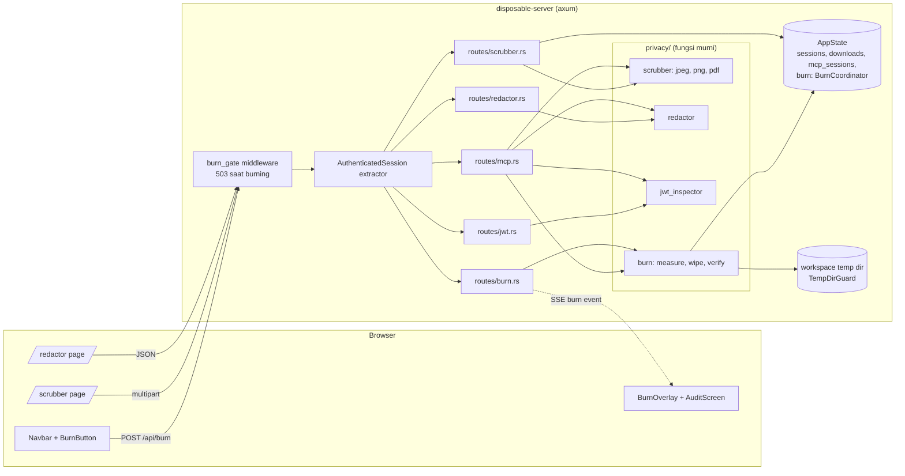

# Dokumen Desain

## Overview

Fitur ini menambahkan tiga kemampuan ke Disposable Service Workspace:

1. **Metadata Scrubber** (`/api/apps/scrubber`): menghapus metadata sensitif dari JPEG, PNG, dan PDF, seluruhnya di memori.
2. **Secret Redactor + JWT Inspector** (`/api/apps/redactor`, `/api/apps/jwt`): menyamarkan rahasia pada teks/`.env`/log dan mendekode JWT tanpa mengirim data ke pihak ketiga.
3. **Burn Workspace** (`POST /api/burn`, tool MCP `burn_workspace_now`): mengosongkan Managed_Storage, memberi bukti audit 0 byte, lalu menghentikan proses server.

Keputusan desain utama:

| Keputusan | Alasan |
|---|---|
| Logika inti ditulis sebagai fungsi murni di modul `privacy/` (tanpa axum), route hanya adaptor tipis. | Pola `pandoc.rs` memisahkan `generate_pandoc_pdf_bytes` dari handler; REST dan MCP wajib menghasilkan keluaran identik (Req 8.2, 8.3), jadi keduanya memanggil fungsi yang sama. Fungsi murni juga cocok untuk property-based testing. |
| Scrubber JPEG/PNG bekerja pada level segmen/chunk byte (tidak decode/re-encode piksel). | Menjamin piksel identik (Req 1.2) dan idempotensi byte-per-byte (Req 1.8) secara konstruksi. Tidak ada kompresi ulang. |
| Scrubber PDF memakai crate `lopdf`. | Perlu menghapus `/Info` dan stream `/Metadata` dan menyerialkan ulang dokumen secara deterministik. |
| Redactor memakai `regex` dengan pemilihan kecocokan satu-lintasan dan "span terlindungi" untuk placeholder yang sudah ada. | Menjamin idempotensi (Req 5.9) dan jumlah baris tetap (Req 5.10). |
| JWT diinspeksi dengan decoder manual (base64url + `serde_json`), HMAC dengan crate `hmac` + `sha2`. | `jsonwebtoken::decode` menolak token tanpa verifikasi dan tidak mengekspos header `alg: none`. Inspeksi harus tetap menghasilkan data untuk token tidak valid tanda tangannya. |
| Burn dikoordinasikan oleh `BurnCoordinator` (single-flight via `tokio::sync::OnceCell`) di `AppState`. | Req 10.7 menuntut prosedur tepat satu kali dan Audit_Report identik untuk semua pemanggil bersamaan. |
| Proses berhenti lewat `Notify` yang membuat `main` keluar normal (kode 0), ditambah watchdog thread OS (kode 1). | Req 12.1 dan 12.6. `process::exit` langsung dari handler tidak akan menunggu respons terkirim. |
| Deteksi restart policy lewat env `DISPOSABLE_RESTART_POLICY` yang diisi dari variabel yang sama dengan `restart:` di compose. | Proses di dalam container tidak bisa membaca konfigurasi compose. Lihat bagian "Temuan: restart policy". |

### Temuan: restart policy di `deploy/docker-compose.yml`

Hasil pembacaan berkas: service `disposable-workspace` memakai `restart: unless-stopped`. Konsekuensinya:

- Docker menjalankan ulang container yang keluar dengan kode 0 pada policy `unless-stopped` (dan `always`). Container hanya tetap mati jika dihentikan manual via `docker stop`/`compose down`. Akibatnya, tanpa perubahan, Burn akan diikuti restart otomatis, sehingga Req 12.2 (tetap berhenti) **tidak terpenuhi** oleh konfigurasi saat ini. Pada restart, `AppState` kosong sehingga `/setup` muncul lagi, kecuali `DISPOSABLE_PASSWORD_HASH` diset di env.
- Req 12.3 sudah mengantisipasi ini: pada `unless-stopped`/`always`, Audit_Report wajib memuat peringatan, dan penghentian tetap dilanjutkan.
- `crates/cli/src/deployer.rs` menanam compose lewat `include_str!("../../../deploy/docker-compose.yml")` dan mengunggahnya saat `deploy`. Jadi perubahan pada berkas compose otomatis ikut ke deployment baru. `teardown` memakai `docker compose down -v` dan tidak bergantung pada Burn (Req 14.7).

Desain yang diusulkan:

- Compose diparametrisasi: `restart: ${RESTART_POLICY:-on-failure}` dan `DISPOSABLE_RESTART_POLICY=${RESTART_POLICY:-on-failure}` pada `environment`. Satu variabel mengisi dua tempat, sehingga nilai yang dilaporkan server tidak bisa menyimpang dari nilai yang dipakai Docker.
- Default `on-failure` dipilih agar container tetap pulih saat crash (exit non-0), tetapi tetap mati setelah Burn (exit 0). Perubahan default dari `unless-stopped` ini mengubah perilaku deployment yang ada, jadi perlu persetujuan pengguna (lihat "Pertanyaan Terbuka").
- Server membaca env tersebut saat startup. Nilai tidak dikenal atau env tidak ada diperlakukan sebagai "tidak diketahui" dan **menghasilkan peringatan** (sisi aman). Ini perluasan kecil dari Req 12.3 yang hanya menyebut `always`/`unless-stopped`.

## Architecture



### Urutan Burn

```mermaid
sequenceDiagram
    participant UI as Browser
    participant H as POST /api/burn
    participant B as BurnCoordinator
    participant S as AppState + temp dir
    participant M as main()

    UI->>H: POST (cookie JWT)
    H->>B: run_or_join()
    B->>B: set burning=true (gate mulai 503)
    B->>S: measure(before)
    B->>S: broadcast event "burn" ke UI (lihat catatan)
    B->>S: wipe downloads (zero + clear)
    B->>S: clear mcp_sessions (SSE stream berakhir)
    B->>S: clear sessions
    B->>S: wipe temp dir
    B->>S: measure(after) <= timeout 5 detik
    B-->>H: AuditReport (disimpan di OnceCell)
    H-->>UI: 200 JSON + Set-Cookie removal
    H->>B: schedule_shutdown(body selesai atau 2 detik; batas keras 5 detik sejak trigger)
    B->>M: Notify shutdown
    M-->>M: return Ok(()) => exit 0
    Note over M: watchdog thread: +3 detik => stderr + exit(1)
```

Catatan: event SSE `burn` ke sesi UI (Req 13.5) hanya dikirim ketika burn dipicu lewat MCP. Untuk burn dari UI, sesi pemicu menerima laporan lewat respons HTTP, sedangkan tab UI lain tetap menerimanya lewat channel broadcast yang sama.

### Penempatan Kode (mengikuti pola yang ada)

Pola saat ini: `routes/<app>.rs` berisi handler dan logika, `state.rs` memegang `AppState`, DTO bersama di `crates/common/src/lib.rs`, route didaftarkan di `routes/mod.rs::create_api_router`, tool MCP dikirim lewat `match tool_name` di `routes/mcp.rs`, dan halaman frontend berupa `pages/<x>.astro` yang membungkus `AppRouter` (`client:only="react"`).

```
crates/common/src/lib.rs            + DTO: ScrubReport, RedactRequest/Response, JwtInspectRequest/Result, AuditReport, ...
crates/server/src/privacy/mod.rs    (baru) modul fungsi murni
crates/server/src/privacy/scrubber/{mod,jpeg,png,pdf}.rs
crates/server/src/privacy/redactor.rs
crates/server/src/privacy/jwt_inspector.rs
crates/server/src/privacy/burn.rs   BurnCoordinator, measure, wipe, verify
crates/server/src/routes/{scrubber,redactor,jwt,burn}.rs   (baru) adaptor HTTP
crates/server/src/routes/mod.rs     + rute baru + burn_gate layer
crates/server/src/routes/mcp.rs     + 4 tool baru
crates/server/src/state.rs          + field burn, ui_events; + measure helpers; + workspace_tmp_root()
crates/server/src/routes/pandoc.rs  temp dir dialihkan ke workspace_tmp_root()
crates/server/src/main.rs           shutdown via Notify + watchdog
frontend/src/pages/{scrubber,redactor}.astro
frontend/src/components/{MetadataScrubber,RedactorPage,JwtInspectorTab,LogRedactorTab,BurnButton,BurnConfirmDialog,BurnOverlay,AuditScreen}.tsx
frontend/src/components/{Navbar,DashboardView,AppRouter}.tsx   diubah
deploy/docker-compose.yml           restart policy diparametrisasi
```

Dependensi baru di `crates/server/Cargo.toml` (versi dipin saat implementasi): `lopdf`, `regex`, `hmac`, `zeroize`; dev-dependency: `proptest`. `sha2`, `base64`, `serde_json` sudah ada. Sisi frontend: `fast-check` dan `vitest` (dev) untuk properti komponen/logika klien bila diperlukan.

## Components and Interfaces

### 1. Route dan kontrak HTTP

| Rute | Metode | Auth | Body | Keberhasilan | Galat |
|---|---|---|---|---|---|
| `/api/apps/scrubber` | POST | wajib | multipart, field `file`; query `mode=direct\|ephemeral` (default `direct`) | `direct`: 200 file bersih + header `Content-Disposition: attachment`, `Cache-Control: no-store`, `X-Scrub-Report` (JSON, base64url). `ephemeral`: 200 JSON `{token, download_url, report, filename}` | 401, 413, 415, 422, 503 |
| `/api/apps/scrubber/download/:token` | GET | token (pola pandoc) | - | 200 file, burn-after-reading | 404 |
| `/api/apps/redactor` | POST | wajib | JSON `RedactRequest` | 200 JSON `RedactResponse` | 400, 401, 413, 503 |
| `/api/apps/jwt` | POST | wajib | JSON `JwtInspectRequest` | 200 JSON `JwtInspectResult` | 401, 422, 503 |
| `/api/burn` | POST | wajib | kosong | 200 JSON `AuditReport` + `Set-Cookie` penghapusan | 401 |
| `/api/burn/events` | GET (SSE) | wajib | - | stream event `burn` | 401 |

Keputusan terkait kontrak:

- **Scrub_Report di mode `direct`**: respons berisi file biner, jadi Scrub_Report dikirim lewat header `X-Scrub-Report` (JSON, base64url, hanya nama kategori dan jumlah). Frontend perlu membacanya dengan `res.headers.get(...)`. Alternatif, `ephemeral` mengembalikan laporan di body JSON. Halaman `/scrubber` memakai mode `direct` agar tidak ada salinan yang tinggal di server.
- **Urutan penolakan**: `AuthenticatedSession` adalah argumen pertama handler sehingga 401 terjadi sebelum body dibaca (Req 1.4, 5.8). `burn_gate` berjalan lebih luar dari auth, jadi saat burning semua rute `/api/apps/*` dan `/api/mcp/*` mengembalikan 503 tanpa membaca body (Req 10.6). `/api/burn`, `/api/burn/events`, dan `/api/auth/status` dikecualikan dari gate.
- **Batas ukuran**: `DefaultBodyLimit` per rute dipasang lebih longgar dari batas logis (scrubber 25 MiB + 1 MiB overhead multipart, redactor 16 MiB karena escaping JSON), lalu handler memeriksa ukuran sebenarnya: file > 26.214.400 byte atau teks > 5.242.880 byte menghasilkan 413 dengan pesan batas. Body yang melewati limit axum juga menghasilkan 413.
- **Urutan validasi scrubber**: ukuran (413) -> tipe berdasarkan magic bytes (415) -> parse (422). Tipe ditentukan dari magic bytes, bukan dari nama file atau Content-Type klien, dan nama file tidak pernah dicatat.
- **Rute unduhan**: handler `download_pandoc_ephemeral` dipakai ulang untuk `/api/apps/scrubber/download/:token` (mengambil dari `downloads` yang sama), dengan penambahan `Cache-Control: no-store`.

### 2. `privacy::scrubber`

```rust
pub const MAX_UPLOAD_BYTES: usize = 25 * 1024 * 1024; // 26_214_400

pub enum FileKind { Jpeg, Png, Pdf }

pub enum ScrubError {
    TooLarge,                 // 413
    UnsupportedType,          // 415
    Unreadable(&'static str), // 422, alasan statis tanpa data pengguna
    EncryptedPdf,             // 422
}

pub fn sniff(bytes: &[u8]) -> Option<FileKind>;
pub fn scrub(bytes: &[u8]) -> Result<ScrubOutput, ScrubError>;
pub fn scan(bytes: &[u8]) -> Result<ScrubReport, ScrubError>; // jumlah Sensitive_Metadata yang masih ada, untuk verifikasi/tes

pub struct ScrubOutput { pub kind: FileKind, pub bytes: Vec<u8>, pub report: ScrubReport }
```

Aturan per format:

- **JPEG** (`jpeg.rs`): iterasi segmen marker dari SOI sampai SOS. Hapus APP1 (EXIF dan XMP, termasuk thumbnail tertanam), APP13 (IPTC/Photoshop), APP12, APP15, dan COM. Pertahankan APP0 (JFIF), APP2 (profil ICC, bukan data identitas), DQT/SOF/DHT/DRI/SOS dan seluruh data entropy-coded. Setelah SOS, byte disalin apa adanya sampai EOI. Kategori dihitung dari isi EXIF sebelum dibuang (GPS, serial body/lensa, owner/artist, software, thumbnail, XMP, IPTC) lewat parser TIFF-IFD minimal; hanya **nama kategori dan jumlah entri** yang disimpan, tidak pernah nilainya.
- **PNG** (`png.rs`): validasi signature dan CRC chunk. Hapus `eXIf`, `tEXt`, `zTXt`, `iTXt`, `tIME`; pertahankan semua chunk lain (IHDR, PLTE, IDAT, IEND, gAMA, sRGB, iCCP, dll.) tanpa menyentuh IDAT. Chunk `iTXt` dengan keyword `XML:com.adobe.xmp` dihitung sebagai kategori XMP.
- **PDF** (`pdf.rs`): `lopdf::Document::load_mem`. Tolak jika `is_encrypted()` (422 `EncryptedPdf`). Hapus entri `/Info` dari trailer beserta objeknya, hapus `/Metadata` dari katalog dan dari objek halaman bila ada, lalu `prune_objects` dan simpan ke `Vec<u8>` dengan ID objek dan urutan deterministik. Field yang ada dicatat sebagai nama saja (Author, Creator, Producer, Title, Subject, Keywords, CreationDate, ModDate). Periksa header `%PDF-` sebelum parse.
- **Idempotensi**: `scrub(scrub(x).bytes).bytes == scrub(x).bytes`. Untuk JPEG/PNG ini otomatis benar karena operasi hanya menghapus segmen. Untuk PDF, serialisasi harus deterministik dan tidak menyisipkan `/Producer` atau ID baru; ini diverifikasi oleh property test dan, bila `lopdf` ternyata menambahkan metadata, ditangani dengan menulis ulang trailer sendiri.
- **Zero-footprint**: seluruh pemrosesan memakai `&[u8]`/`Vec<u8>` di memori; tidak ada file sementara. Bila implementasi PDF ternyata memerlukan file sementara, file itu harus berada di `workspace_tmp_root()` di bawah `TempDirGuard` (Req 3.2, 14.1).
- **CPU-bound**: `scrub` dijalankan lewat `tokio::task::spawn_blocking` agar tidak memblokir runtime. Handler memegang buffer asli dan hasil dalam satu scope sehingga keduanya dibebaskan saat respons selesai atau klien terputus (drop future) (Req 3.4, 3.5).

### 3. `privacy::redactor`

```rust
pub const MAX_TEXT_BYTES: usize = 5_242_880;
pub const MAX_CUSTOM_WORDS: usize = 100;
pub const MAX_CUSTOM_WORD_CHARS: usize = 256;

#[derive(Clone, Copy, PartialEq, Eq, Hash, Serialize, Deserialize)]
pub enum Category { Jwt, Bearer, ApiKey, EnvValue, Email, Phone, Ipv4, Ipv6, CreditCard, Custom }

pub enum Format { Auto, Env, Text }

pub struct RedactOptions {
    pub categories: BTreeSet<Category>,   // default: semua kategori bawaan aktif
    pub custom_words: Vec<String>,
    pub format: Format,                   // default Auto
}

pub fn validate(opts: &RedactOptions) -> Result<(), RedactError>; // 400
pub fn redact(text: &str, opts: &RedactOptions) -> RedactOutcome;

pub struct RedactOutcome { pub text: String, pub counts: BTreeMap<Category, usize> }
```

Algoritma (satu lintasan, deterministik):

1. **Span terlindungi**: temukan semua placeholder yang sudah ada dengan pola persis `\[REDACTED:(jwt|bearer|api_key|env_value|email|phone|ipv4|ipv6|credit_card|custom)\]`. Span ini tidak boleh dicocokkan oleh aturan apa pun, termasuk kata kustom. Ini kunci idempotensi (Req 5.9).
2. **Mode `.env`**: baris yang cocok `^\s*(export\s+)?[A-Za-z_][A-Za-z0-9_]*=(.*)$` dan bukan komentar (`#`) adalah baris assignment. `Format::Auto` memilih mode env bila setiap baris tak kosong dan non-komentar adalah assignment. Pada mode env dan kategori `EnvValue` aktif, nilai non-kosong diganti `[REDACTED:env_value]`; nama variabel, `=`, spasi sebelumnya, dan komentar tidak berubah (Req 5.2). Nilai kosong dibiarkan.
3. **Aturan teks** dikumpulkan sebagai kandidat `(start, end, kategori, prioritas)` per segmen di antara span terlindungi, untuk kategori aktif saja:
   - `Jwt`: tiga segmen base64url dipisah titik dengan segmen awal diawali `eyJ`.
   - `Bearer`: `(?i)bearer\s+[A-Za-z0-9._~+/=-]{8,}` (hanya tokennya yang diganti).
   - `ApiKey`: pola prefiks umum (`sk-`, `AKIA...`, `ghp_`, `xox[bap]-`, dsb.) dan pasangan `api[_-]?key|secret|token|password` `[:=]` nilai.
   - `Email`, `Ipv4` (oktet 0-255), `Ipv6`, `Phone` (format internasional dengan 8-15 digit).
   - `CreditCard`: 13-19 digit (boleh spasi/tanda hubung) dan lolos uji Luhn.
   - `Custom`: setiap kemunculan kata kustom, sensitif huruf besar/kecil, pencocokan literal (`regex::escape`).
4. **Resolusi tumpang tindih**: urutkan kandidat berdasarkan `(start asc, panjang desc, prioritas)`, ambil secara greedy yang tidak tumpang tindih dengan yang sudah dipilih dan span terlindungi.
5. **Penjagaan jumlah baris** (Req 5.10): aturan bawaan tidak pernah mencocokkan `\n`. Untuk kata kustom yang mengandung `\n`, penggantinya adalah placeholder diikuti `\n` sebanyak jumlah `\n` di kecocokan, sehingga jumlah baris tetap sama.
6. `counts` diisi 0 untuk setiap kategori aktif tanpa kecocokan (Req 5.3).

`validate` menolak (400) daftar > 100 kata, kata kosong, atau kata > 256 karakter (dihitung per `char`), dengan pesan yang menyebut batasan yang dilanggar tanpa mengutip isi kata. Teks > 5.242.880 byte ditolak di route (413), sebelum `redact` dipanggil.

### 4. `privacy::jwt_inspector`

```rust
pub const MAX_TOKEN_CHARS: usize = 8192;
pub const MAX_SECRET_BYTES: usize = 1024;

pub struct InspectOptions<'a> { pub hmac_secret: Option<&'a [u8]>, pub redact: bool }

pub fn inspect(token: &str, opts: &InspectOptions, now_unix: i64) -> Result<JwtInspectResult, JwtError>;

pub enum JwtError {
    TokenLength,                  // 422, menyebut batas 8.192
    Structure,                    // bukan tepat 3 segmen
    Segment(Segment),             // Header | Payload | Signature bermasalah (base64url/JSON), 422
    SecretLength,                 // 422, 1..=1024 byte
}
```

- **Dekode**: `split('.')` harus tepat 3 bagian. Header dan payload didekode base64url (tanpa padding, `URL_SAFE_NO_PAD`), diparse sebagai JSON object; segmen signature divalidasi sebagai base64url. Galat menyebut nama segmen (`header`, `payload`, `signature`) dan tidak mengembalikan hasil parsial (Req 6.5).
- **Klaim waktu**: untuk `exp`, `iat`, `nbf` yang berupa integer detik Unix (`serde_json::Number::as_i64`, rentang yang dapat dikonversi ke `DateTime<Utc>`), tampilkan ISO 8601 UTC. Selain itu, nilai asli ditampilkan apa adanya dengan `valid: false` (Req 6.3). Status: `expired` bila `now >= exp`; `not_yet_valid` bila `now < nbf`; selain itu `active`. Bila keduanya berlaku, `expired` didahulukan (pilihan desain; requirements tidak menetapkan prioritas). Fungsi menerima `now_unix` agar dapat diuji deterministik.
- **`alg: none`**: dibandingkan dengan `eq_ignore_ascii_case("none")`, menambah entri `warnings` bahwa token tidak ditandatangani.
- **Verifikasi HMAC**: hanya `HS256/HS384/HS512`; `hmac::Mac::verify_slice` (waktu konstan) atas `"{header_b64}.{payload_b64}"` dengan segmen asli. Hasil `valid`/`invalid`. Algoritma lain dengan secret -> `unsupported` dan hasil dekode tetap dikembalikan (Req 6.8).
- **Redaksi**: bila `redact`, nilai untuk kunci `email`, `phone_number`, `phone`, `sub`, `name`, `preferred_username` diganti `"[REDACTED:<kategori>]"` di seluruh pohon JSON (rekursif pada objek dan array; mencakup kedalaman 5 yang diwajibkan, kedalaman lebih dalam ikut disamarkan, dibatasi limit rekursi `serde_json` 128). Redaksi hanya memengaruhi tampilan, bukan verifikasi tanda tangan.
- **Penghapusan memori** (Req 6.10): token dan secret dibungkus `zeroize::Zeroizing` di handler dan dihapus sebelum respons dikembalikan. Ini upaya terbaik: salinan sementara di buffer HTTP/serde tidak dapat dijamin terhapus.
- **Round trip** (Req 6.12): `JwtInspectResult` menyimpan `header` dan `payload` sebagai `serde_json::Value`. Menyandikan ulang kedua nilai itu ke base64url dan mendekodenya kembali menghasilkan `Value` yang sama dengan hasil dekode token asli.

### 5. `privacy::burn` dan `BurnCoordinator`

```rust
pub struct BurnCoordinator {
    burning: AtomicBool,                         // dibaca burn_gate
    report: tokio::sync::OnceCell<Arc<AuditReport>>,
    shutdown: tokio::sync::Notify,
    triggered_at: OnceLock<Instant>,
}

impl BurnCoordinator {
    pub fn is_burning(&self) -> bool;
    pub async fn run_or_join(&self, state: &AppState) -> Arc<AuditReport>; // OnceCell::get_or_init => tepat sekali
    pub fn schedule_shutdown(&self, body_done: impl Future<Output = ()>);
    pub async fn shutdown_requested(&self);
}
```

Langkah `run` (setiap langkah dibungkus agar kegagalan satu item tidak menghentikan item lain, Req 10.8):

1. `burning = true`; catat `started_at`.
2. `before = measure(state)`.
3. `downloads`: `drain()`, untuk setiap entri nolkan `data` dengan `zeroize` (menulis nol pada seluruh panjang lewat volatile write) sebelum `drop`.
4. `mcp_sessions`: `drain()` (menjatuhkan semua `Sender` sehingga stream SSE berakhir setelah event yang sudah antre terkirim). Dibatasi `timeout(5s)`.
5. `sessions`: `clear()`. Pemanggil REST menambahkan header `Set-Cookie` penghapusan (pola `logout`: `make_removal()`, `max_age(ZERO)`).
6. Temp dir: hapus isi `workspace_tmp_root()` (file dan subdirektori), item yang gagal dicatat sebagai `FailedItem { category, reason }` tanpa nama berkas pengguna.
7. `after = measure(state)` di bawah `timeout(5s)`. Bila timeout atau gagal baca: `verified=false`, `incomplete=true`.
8. Susun `AuditReport`, `OnceCell` menyimpannya; panggilan bersamaan mendapat `Arc` yang sama (identik).

`measure` memakai kategori tetap: `sessions`, `downloads`, `mcp_sessions`, `temp_dir`. Byte tiap kategori = jumlah panjang byte data tersimpan (untuk `downloads`: `data.len() + filename.len() + content_type.len()`; `sessions`: total panjang string dan 16 byte untuk dua `i64`; `mcp_sessions`: `session_id.len()` per entri; `temp_dir`: jumlah ukuran file rekursif). `verified` hanya `true` bila semua entri dan byte `after` bernilai 0 dan verifikasi selesai.

Penghentian proses (Req 12):

- Setelah laporan siap, `schedule_shutdown` menunggu yang lebih dulu antara: body respons selesai dikirim, atau 2 detik. Terpisah dari itu, timer 5 detik sejak pemicuan selalu memanggil `shutdown.notify_one()` (klien terputus, Req 12.4). Body respons dibungkus stream yang memberi sinyal saat habis atau di-drop.
- Untuk burn lewat MCP/SSE: sinyal "selesai terkirim" adalah `Sender::closed()` (stream SSE sudah habis dan receiver di-drop) dengan batas 5 detik (Req 13.2, 13.4).
- `main` mengganti `with_graceful_shutdown(shutdown_signal())` dengan `tokio::select!` antara `axum::serve(...).with_graceful_shutdown(shutdown_signal())` dan `state.burn.shutdown_requested()`. Cabang kedua mengembalikan `Ok(())` sehingga proses keluar dengan kode 0 tanpa menunggu koneksi keep-alive.
- **Watchdog**: begitu shutdown diminta, thread OS (`std::thread::spawn`, tidak bergantung runtime tokio) tidur 3 detik, lalu menulis kegagalan ke stderr (`eprintln!`) dan memanggil `std::process::exit(1)` (Req 12.6).
- **Peringatan restart policy**: `AuditReport.warnings` diisi bila `DISPOSABLE_RESTART_POLICY` bernilai `always`, `unless-stopped`, atau tidak diketahui. Lihat "Temuan: restart policy".
- **Req 12.5**: pembersihan temp dir di langkah 6 dan penggunaan `workspace_tmp_root()` oleh seluruh fitur memastikan tidak ada file pengguna yang tersisa di filesystem yang dapat ditulis.

### 6. Integrasi MCP (`routes/mcp.rs`)

`tools/list` ditambah empat tool (tool lama `convert_markdown_to_pdf` dan `get_host_metrics` tidak diubah):

| Tool | Argumen | Hasil |
|---|---|---|
| `redact_secrets` | `text` (1..1.048.576 karakter), opsional `categories`, `custom_words`, `format` | JSON `RedactResponse` (sama dengan REST) |
| `inspect_jwt` | `token` (1..8.192), opsional `secret`, `redact` | JSON `JwtInspectResult` (sama dengan REST) |
| `scrub_metadata` | `file_base64` (hasil dekode 1..26.214.400 byte), opsional `filename` | URL unduhan + `ScrubReport`; file disimpan sebagai Ephemeral_Download TTL 300 detik |
| `burn_workspace_now` | `confirm` (boolean true), `title: "Burn Workspace Now"`, deskripsi menyatakan permanen dan tidak dapat dibatalkan | `AuditReport` |

- Validasi argumen dilakukan **sebelum** tool berjalan. Argumen tidak valid mengembalikan galat JSON-RPC `{"code": -32602, "message": "..."}` dengan pesan yang menyebut nama argumen (Req 8.6, 13.3). Ini berbeda dari pola tool lama, yang membungkus galat di `result.isError`; untuk tool baru requirements menuntut kode JSON-RPC, jadi `rpc_response` cabang `tools/call` perlu bisa menghasilkan objek `error`. Kegagalan burn memakai `-32603` (Req 13.6), burn yang sedang berjalan mengembalikan galat JSON-RPC lain dengan pesan "penghancuran sedang berlangsung" (Req 13.7).
- 401 untuk klien tanpa sesi tetap datang dari `AuthenticatedSession`, yang sudah berjalan sebelum body diparse.
- **Burn lewat SSE**: cabang SSE saat ini memeriksa `mcp_sessions.contains_key(sid)` setelah tool selesai; setelah burn map sudah kosong sehingga jatuh ke jalur HTTP standalone. Perbaikannya: sebelum memanggil `run_or_join`, ambil `Sender` klon dari `mcp_sessions[sid]`; kirim hasil lewat klon itu, lalu jatuhkan (drop). Stream menghabiskan event yang antre lalu berakhir, sehingga koneksi ditutup setelah event lengkap terkirim.
- **Event `burn` ke UI** (Req 13.5): `AppState` mendapat `ui_events: broadcast::Sender<Arc<AuditReport>>`. `GET /api/burn/events` (SSE, terautentikasi) berlangganan dan meneruskan `event: burn`. `BurnCoordinator` mengirim ke channel ini dalam 2 detik sejak mulai. Channel ini bukan bagian Managed_Storage (tidak menyimpan data pengguna).

### 7. Frontend

Mengikuti pola yang ada: halaman `.astro` tipis -> `AppRouter` (`client:only="react"`) -> komponen React; kelas Tailwind v4 dari token di `global.css` (`bg-surface-soft`, `text-ink`, `bg-rausch`, `dark:bg-dark-card`, dst.). Tidak ada nilai heksadesimal di komponen baru (Req 4.7). Untuk warna destruktif Burn Button dipakai token `airbnb-error` (`--color-airbnb-error`).

| Komponen | Tanggung jawab |
|---|---|
| `AppRouter.tsx` | Tambah `'scrubber' \| 'redactor'` ke `page` dan `PAGE_PATH`; render `MetadataScrubber` / `RedactorPage`. Sudah ada `FloatingMonitor` di semua halaman non-monitor; tidak diubah. |
| `Navbar.tsx` | Tambah dua tautan nav (`/scrubber`, `/redactor`) dengan gaya aktif yang sama dengan tautan lama, dan `BurnButton` di blok kanan. Navbar hanya dirender setelah `AppRouter` memastikan sesi terautentikasi, jadi Req 9.1 terpenuhi di semua halaman ber-Navbar. |
| `DashboardView.tsx` | Tambah dua kartu layanan (Scrubber, Redactor) mengikuti struktur kartu Pandoc/Monitor. |
| `MetadataScrubber.tsx` | Dropzone atau input file; tampil nama + ukuran (B/KB/MB, maks 2 desimal) saat file dipilih, sebelum upload; hanya file pertama diterima + pemberitahuan bila >1; `fetch` dengan `AbortController` timeout 60 dtk; tampil Scrub_Report dan memulai unduhan via `Blob` + `URL.createObjectURL` (revoke setelahnya) dalam 2 dtk; pada galat tampil pesan server atau pesan umum, file terpilih dipertahankan, kontrol aktif lagi dalam 1 dtk. |
| `RedactorPage.tsx` | Tepat dua tab: "JWT Inspector" (default) dan "Log & .env Redactor"; konten tab disembunyikan/ditampilkan tanpa reload. Efek cleanup (unmount, `beforeunload`, `pagehide`) mengosongkan seluruh state. Tidak menyentuh `localStorage`, `sessionStorage`, atau cookie. |
| `LogRedactorTab.tsx` | Textarea masukan (batas 1.048.576 karakter di klien, pesan galat + mempertahankan teks bila terlampaui), toggle kategori, daftar kata kustom, dua panel berdampingan di `md:` (>= 768 px), tombol salin dengan konfirmasi 2 dtk dan pesan galat bila `navigator.clipboard` gagal. |
| `JwtInspectorTab.tsx` | Input token, secret HMAC opsional, opsi redaksi; tampil header/payload terformat, waktu ISO, status, peringatan, hasil verifikasi. |
| `BurnButton.tsx` | Tombol mencolok dengan label teks terlihat "Burn Workspace" dan `aria-label` yang menyatakan aksi burn. Dua jalur: `BurnConfirmDialog` (Setuju/Batal/Escape, muncul <= 200 ms) atau, bila Demo mode aktif, hitung mundur 3-2-1 dengan tombol "Batal". Maksimal satu `POST /api/burn` per sesi klik (tombol dinonaktifkan setelah kirim), timeout 10 detik via `AbortController`. Pada galat tampil pesan burn gagal dan tombol aktif lagi. |
| `BurnOverlay.tsx` + `AuditScreen.tsx` | Setelah `AuditReport` diterima: animasi hitung mundur 1-10 detik, lalu layar audit: tabel sebelum/sesudah per kategori, durasi, waktu UTC, peringatan; indikator teks "0 bytes remaining" **hanya** bila `verified === true`; bila `false`, tampil byte tersisa dan kategori tersisa. Selalu menampilkan pernyataan bahwa cakupan verifikasi adalah Managed_Storage, bukan seluruh memori proses. Komponen ini juga berlangganan `GET /api/burn/events` (EventSource) untuk burn yang dipicu MCP. |

Logika yang bisa diuji tanpa DOM dipisahkan ke fungsi murni di `frontend/src/lib/` (mis. `formatFileSize`, `shouldShowZeroBytes(report)`, `validateRedactorInput(text)`) agar dapat dites properti.

### 8. Perubahan `AppState`

```rust
pub struct AppState {
    // ... field yang ada
    pub burn: Arc<BurnCoordinator>,
    pub ui_events: broadcast::Sender<Arc<AuditReport>>,
}
```

`AppState::new()` membuat keduanya. Method baru: `measure_managed_storage()` (menghitung `StorageSnapshot`) dan `wipe_downloads()`. Semua method lama tidak berubah. `workspace_tmp_root()` mengembalikan `std::env::temp_dir().join("disposable-workspace")` dan dipakai `pandoc.rs` (`pandoc-job-*` kini berada di bawahnya) serta fitur baru.

## Data Models

Ditambahkan di `crates/common/src/lib.rs` (semua `Debug, Clone, Serialize, Deserialize`; yang dibandingkan di tes juga `PartialEq`).

```rust
// --- Scrubber ---
pub struct ScrubCategoryCount { pub category: String, pub count: usize }   // "gps", "device_serial", "author", "software", "thumbnail", "xmp", "iptc", "pdf_info:Author", ...
pub struct ScrubReport { pub file_kind: String, pub removed: Vec<ScrubCategoryCount> } // tanpa nilai metadata
pub struct ScrubEphemeralResponse { pub token: String, pub download_url: String, pub filename: String, pub report: ScrubReport, pub expires_in_secs: u64 }

// --- Redactor ---
pub struct RedactRequest {
    pub text: String,
    #[serde(default)] pub categories: Option<Vec<String>>, // None = semua bawaan aktif
    #[serde(default)] pub custom_words: Vec<String>,
    #[serde(default)] pub format: Option<String>,          // "auto" | "env" | "text"
}
pub struct RedactResponse { pub text: String, pub counts: BTreeMap<String, usize> }

// --- JWT ---
pub struct JwtInspectRequest { pub token: String, #[serde(default)] pub secret: Option<String>, #[serde(default)] pub redact: bool }
pub struct ClaimTime { pub claim: String, pub raw: serde_json::Value, pub iso: Option<String>, pub valid: bool }
pub enum TokenStatus { Active, Expired, NotYetValid }               // serde: snake_case
pub enum SignatureCheck { NotRequested, Valid, Invalid, Unsupported } // serde: snake_case
pub struct JwtInspectResult {
    pub header: serde_json::Value, pub payload: serde_json::Value,
    pub header_pretty: String, pub payload_pretty: String,       // indentasi 2 spasi
    pub times: Vec<ClaimTime>, pub status: TokenStatus,
    pub signature: SignatureCheck, pub warnings: Vec<String>,
}

// --- Burn ---
pub struct CategoryStat { pub category: String, pub entries: u64, pub bytes: u64 }  // category dari daftar tetap
pub struct FailedItem { pub category: String, pub reason: String }                  // tanpa nama berkas/token
pub struct AuditReport {
    pub verified: bool,
    pub incomplete: bool,
    pub before: Vec<CategoryStat>, pub after: Vec<CategoryStat>,
    pub total_bytes_before: u64, pub remaining_bytes: u64,
    pub remaining_categories: Vec<CategoryStat>,
    pub removed_items: u64, pub failed_items: Vec<FailedItem>,
    pub duration_ms: u64, pub timestamp_utc: String,   // RFC 3339 / ISO 8601, akhiran Z
    pub warnings: Vec<String>,                         // mis. peringatan restart policy
}
```

Invarian model:

- `ScrubReport.removed` hanya memuat kategori dengan `count > 0`; daftar kosong berarti tidak ada metadata (Req 1.3).
- `AuditReport.category` hanya bernilai salah satu dari `sessions`, `downloads`, `mcp_sessions`, `temp_dir`.
- `AuditReport.verified == true` implies `remaining_bytes == 0 && incomplete == false && remaining_categories.is_empty()`.
- `remaining_bytes == sum(after[*].bytes)`.

Konfigurasi compose (`deploy/docker-compose.yml`) yang diusulkan:

```yaml
services:
  disposable-workspace:
    restart: ${RESTART_POLICY:-on-failure}
    environment:
      - DISPOSABLE_RESTART_POLICY=${RESTART_POLICY:-on-failure}
```

## Correctness Properties

*A property is a characteristic or behavior that should hold true across all valid executions of a system-essentially, a formal statement about what the system should do. Properties serve as the bridge between human-readable specifications and machine-verifiable correctness guarantees.*

Refleksi redundansi: 1.1, 1.2, 1.9 digabung menjadi Property 1; 1.8 dan 2.4 menjadi Property 3; 1.5, 1.6, 2.5, dan 3.8 menjadi Property 5; 3.7, 3.9, 8.4 menjadi Property 6; 6.1 dan 6.12 menjadi Property 17; 10.1-10.5, 11.1, 11.2, dan 12.5 menjadi Property 26; 8.6 dan 13.3 menjadi Property 24. Kriteria 401, batas ukuran persis, header, UI, timing, dan proses keluar tidak dijadikan properti (lihat Testing Strategy).

### Property 1: Scrub gambar menghapus metadata dan mempertahankan piksel

*For any* gambar JPEG atau PNG valid dengan kombinasi Sensitive_Metadata apa pun, `scrub` menghasilkan file dengan format yang sama, `scan` pada hasil mengembalikan 0 entri Sensitive_Metadata, dan data piksel (IDAT untuk PNG; byte mulai SOS sampai EOI untuk JPEG, beserta dimensi) identik dengan file asli.

**Validates: Requirements 1.1, 1.2, 1.9**

### Property 2: Scrub_Report akurat

*For any* file JPEG, PNG, atau PDF valid dengan himpunan kategori metadata yang diketahui (dibangkitkan oleh generator), `ScrubReport.removed` memuat tepat kategori yang disisipkan dengan jumlah entri yang sama, tidak memuat nilai metadata, dan kosong bila tidak ada metadata yang disisipkan.

**Validates: Requirements 1.3, 2.1**

### Property 3: Idempotensi scrub

*For any* file JPEG, PNG, atau PDF valid, `scrub(scrub(x).bytes).bytes == scrub(x).bytes`, dan Scrub_Report dari lintasan kedua tidak memuat kategori yang dihapus.

**Validates: Requirements 1.8, 2.4**

### Property 4: Scrub PDF mempertahankan struktur dan konten

*For any* PDF valid tidak terenkripsi dengan N halaman dan teks per halaman, hasil `scrub` dapat dimuat ulang, tidak memiliki `/Info` pada trailer maupun `/Metadata` pada katalog, memiliki N halaman, dan teks yang diekstrak pada setiap halaman sama dengan asli.

**Validates: Requirements 2.1, 2.2**

### Property 5: Input tidak valid ditolak tanpa keluaran atau penyimpanan

*For any* byte sequence yang bukan JPEG/PNG/PDF (magic bytes tidak cocok) `scrub` mengembalikan `UnsupportedType`; *for any* file valid yang dirusak (dipotong, header diubah, CRC/struktur dirusak) atau ukuran 0 byte, `scrub` mengembalikan `Unreadable` tanpa `bytes` parsial; dan pada kedua kasus handler tidak menambah entri pada `downloads` maupun file pada temp dir.

**Validates: Requirements 1.5, 1.6, 2.5, 3.8**

### Property 6: Ephemeral_Download scrubber bersifat sekali pakai dan bertuntun

*For any* file valid yang diproses dalam mode ephemeral (REST maupun tool `scrub_metadata`), token yang dikembalikan menghasilkan tepat byte `scrub(file).bytes` pada pengambilan pertama dengan `expires_at` sama dengan waktu simpan + 300 detik; pengambilan kedua dengan token yang sama, atau pengambilan setelah kedaluwarsa, ditolak sebagai token tidak valid.

**Validates: Requirements 3.7, 3.9, 8.4**

### Property 7: Tidak ada konten pengguna di log

*For any* masukan (file, teks, token, secret, nama file, kata kustom) yang memuat penanda unik, baik pemrosesan berhasil maupun gagal, keluaran log yang ditangkap dari scrubber, redactor, dan JWT inspector tidak memuat penanda tersebut.

**Validates: Requirements 3.6, 5.11, 6.11**

### Property 8: Format ukuran file

*For any* ukuran file non-negatif dalam byte, `formatFileSize` menghasilkan string dengan satuan tepat satu dari B, KB, atau MB dan paling banyak 2 digit desimal, dan nilai yang dibulatkan kembali ke byte berada dalam toleransi pembulatan dari ukuran asli.

**Validates: Requirements 4.3**

### Property 9: Hanya file pertama yang diterima

*For any* daftar file berisi n >= 1 elemen, fungsi pemilih file mengembalikan elemen pertama dan menandai pemberitahuan "hanya satu file" jika dan hanya jika n > 1.

**Validates: Requirements 4.4**

### Property 10: Redaksi mengganti semua rahasia kategori aktif dan menghitungnya

*For any* teks yang disusun dari kalimat acak dengan rahasia yang disisipkan (JWT, bearer token, API key, email, nomor telepon, IPv4, IPv6, nomor kartu lolos Luhn) dan *for any* kumpulan kategori aktif, hasil `redact` tidak memuat nilai rahasia dari kategori aktif, memuat `[REDACTED:<kategori>]` yang sesuai, `counts` memuat setiap kategori aktif (bernilai 0 bila tidak ada kecocokan), dan jumlah penggantian sama dengan jumlah rahasia yang disisipkan.

**Validates: Requirements 5.1, 5.3**

### Property 11: Redaksi `.env` mempertahankan struktur

*For any* berkas `.env` yang dibangkitkan (baris `NAMA=nilai`, nilai kosong, komentar `#`, baris kosong), hasil `redact` mempertahankan nama variabel, tanda `=`, dan baris komentar secara identik, dan mengganti setiap nilai non-kosong dengan `[REDACTED:env_value]` bila kategori `env_value` aktif.

**Validates: Requirements 5.2**

### Property 12: Kategori nonaktif tidak disentuh

*For any* teks dan *for any* himpunan kategori aktif, bagian teks yang hanya cocok dengan kategori nonaktif tetap muncul tanpa perubahan pada hasil, dan `redact` dengan himpunan kosong (tanpa kata kustom) mengembalikan teks asli.

**Validates: Requirements 5.4**

### Property 13: Kata kustom diganti dengan pencocokan sensitif huruf besar/kecil

*For any* daftar kata kustom valid dan *for any* teks, setiap kemunculan literal sebuah kata kustom (yang tidak tumpang tindih dengan placeholder yang sudah ada) diganti `[REDACTED:custom]`, sedangkan kemunculan dengan huruf besar/kecil berbeda tidak diganti oleh kata tersebut.

**Validates: Requirements 5.5**

### Property 14: Validasi daftar kata kustom

*For any* daftar kata kustom yang melanggar salah satu batas (lebih dari 100 kata, ada kata kosong, atau ada kata lebih dari 256 karakter), `validate` mengembalikan galat yang menyebut batasan yang dilanggar, dan *for any* daftar yang memenuhi semua batas `validate` berhasil.

**Validates: Requirements 5.7**

### Property 15: Idempotensi redaksi

*For any* teks dan *for any* konfigurasi (kategori aktif, kata kustom, format), `redact(redact(x).text).text == redact(x).text`.

**Validates: Requirements 5.9**

### Property 16: Redaksi mempertahankan jumlah baris

*For any* teks dan konfigurasi redaksi, jumlah karakter `\n` pada hasil sama dengan jumlah `\n` pada masukan.

**Validates: Requirements 5.10**

### Property 17: Round trip inspeksi JWT

*For any* header dan payload JSON object valid, token `base64url(header).base64url(payload).sig` yang diinspeksi dengan redaksi nonaktif menghasilkan `header` dan `payload` yang ekuivalen secara semantik JSON dengan masukan, `header_pretty` dan `payload_pretty` berindentasi 2 spasi dan jika diparse menghasilkan nilai yang sama, dan menyandikan ulang hasil ke base64url lalu mendekodenya kembali menghasilkan nilai yang sama.

**Validates: Requirements 6.1, 6.12**

### Property 18: Klaim waktu dan status token

*For any* nilai `exp`, `iat`, `nbf` bilangan bulat detik Unix dan *for any* `now`, setiap klaim ditampilkan sebagai ISO 8601 UTC yang jika diparse sama dengan nilai asli; status adalah `expired` bila `now >= exp`, `not_yet_valid` bila tidak expired dan `now < nbf`, selain itu `active`; dan *for any* nilai klaim yang bukan integer detik Unix valid, nilai asli dikembalikan dengan `valid = false` tanpa menggagalkan inspeksi.

**Validates: Requirements 6.2, 6.3**

### Property 19: Peringatan algoritma none

*For any* token dengan header `alg` yang sama dengan "none" tanpa memperhatikan huruf besar/kecil, hasil inspeksi memuat peringatan bahwa token tidak ditandatangani, dan *for any* token dengan `alg` lain tidak memuat peringatan tersebut.

**Validates: Requirements 6.4**

### Property 20: Token cacat ditolak dengan menyebut segmen

*For any* token valid yang satu segmennya (header, payload, atau signature) dirusak menjadi bukan base64url atau bukan JSON (untuk header/payload), atau jumlah segmennya diubah dari tiga, `inspect` mengembalikan galat yang menyebut segmen bermasalah tanpa hasil dekode parsial; dan *for any* token kosong atau lebih panjang dari 8.192 karakter, galat menyebut batas panjang.

**Validates: Requirements 6.5, 6.6**

### Property 21: Verifikasi tanda tangan HMAC

*For any* header dengan `alg` salah satu HS256/HS384/HS512, payload, dan secret S (1-1.024 byte), token yang ditandatangani dengan S dilaporkan `valid` bila diverifikasi dengan S dan `invalid` bila diverifikasi dengan secret berbeda atau payload yang diubah; dan *for any* `alg` di luar HS256/HS384/HS512 bersama secret, hasil adalah `unsupported` dengan hasil dekode tetap dikembalikan.

**Validates: Requirements 6.7, 6.8**

### Property 22: Redaksi klaim identitas JWT

*For any* payload JSON bersarang (kedalaman 1 sampai 5) dengan kunci identitas (`email`, `phone_number`, `phone`, `sub`, `name`, `preferred_username`) pada kedalaman acak, inspeksi dengan opsi redaksi menggantikan nilai semua kunci tersebut dengan placeholder dan membiarkan kunci lain tidak berubah.

**Validates: Requirements 6.9**

### Property 23: Paritas MCP dan REST

*For any* masukan valid, hasil tool MCP `redact_secrets` identik dengan `redact` yang dipakai REST, dan hasil `inspect_jwt` identik dengan `inspect` untuk token dan opsi yang sama.

**Validates: Requirements 8.2, 8.3**

### Property 24: Argumen tool MCP tidak valid ditolak tanpa efek samping

*For any* tool MCP baru dan *for any* argumen tidak valid (argumen wajib hilang, tipe salah, kosong, melebihi batas, base64 rusak, atau `confirm` bukan boolean `true` termasuk string "true"), respons adalah galat JSON-RPC -32602 yang menyebut argumen bermasalah, `downloads` tidak bertambah, dan Burn_Service tidak dijalankan.

**Validates: Requirements 8.6, 13.3**

### Property 25: Validasi masukan redactor di klien

*For any* string, `validateRedactorInput` menolak masukan jika dan hanya jika panjangnya lebih dari 1.048.576 karakter, dan penolakan tidak mengubah teks masukan.

**Validates: Requirements 7.5**

### Property 26: Burn mengosongkan seluruh Managed_Storage dan membuktikannya

*For any* `AppState` dan isi temp dir yang dibangkitkan (sesi, unduhan dengan data acak, sesi MCP, pohon file dan subdirektori), setelah `run_or_join` semua kategori kosong (0 entri, 0 byte), `AuditReport` memuat `before` yang sama dengan hasil hitung independen sebelum burn, `verified = true`, `remaining_bytes = 0`, `remaining_categories` kosong, dan respons REST memuat `Set-Cookie` penghapusan cookie sesi.

**Validates: Requirements 10.1, 10.2, 10.3, 10.4, 10.5, 11.1, 11.2, 12.5**

### Property 27: Penimpaan buffer dengan nol

*For any* buffer byte, `wipe_buffer` mengubah setiap byte pada seluruh panjangnya menjadi 0 sebelum buffer dibebaskan, dan panjang buffer saat penimpaan sama dengan panjang asli.

**Validates: Requirements 10.2**

### Property 28: Burn single-flight

*For any* jumlah N >= 1 pemanggil `run_or_join` bersamaan, prosedur pembersihan dieksekusi tepat satu kali dan semua pemanggil menerima `AuditReport` yang identik.

**Validates: Requirements 10.7**

### Property 29: Gate 503 selama burning

*For any* rute micro-app atau MCP (`/api/apps/*`, `/api/mcp/*`) dan *for any* isi permintaan, ketika `burning = true` respons adalah 503 dan handler tidak dijalankan (body tidak diproses).

**Validates: Requirements 10.6**

### Property 30: Burn tahan kegagalan sebagian dan tidak pernah memalsukan verifikasi

*For any* himpunan langkah pembersihan yang dibuat gagal oleh injeksi kegagalan dan *for any* sisa byte yang tertinggal atau kegagalan/timeout saat verifikasi, burn tetap menjalankan semua langkah lainnya, `failed_items` memuat tepat langkah yang gagal, `incomplete = true` bila ada kegagalan, `remaining_bytes` sama dengan jumlah byte sisa per kategori, dan `verified = true` tidak pernah dikembalikan bila ada byte tersisa atau verifikasi tidak lengkap.

**Validates: Requirements 10.8, 11.5, 11.6**

### Property 31: Invarian dan privasi AuditReport

*For any* `AuditReport` yang dihasilkan dari state yang memuat penanda unik pada nama file, token, dan isi, JSON laporan tidak memuat penanda tersebut, setiap nama kategori berasal dari daftar tetap (`sessions`, `downloads`, `mcp_sessions`, `temp_dir`), `timestamp_utc` dapat diparse sebagai ISO 8601 UTC, `duration_ms >= 0`, dan `remaining_bytes` sama dengan jumlah `bytes` pada `after`.

**Validates: Requirements 11.3, 11.4**

### Property 32: Indikator "0 bytes remaining" mengikuti verified

*For any* `AuditReport`, `shouldShowZeroBytes(report)` bernilai true jika dan hanya jika `verified = true` dengan `remaining_bytes = 0`, dan untuk `verified = false` tampilan memuat byte tersisa serta daftar kategori tersisa.

**Validates: Requirements 11.7, 11.8**

### Property 33: Peringatan restart policy

*For any* string nilai kebijakan restart (termasuk `none`/tidak ada), `restart_warning(policy)` mengembalikan peringatan jika nilainya `always`, `unless-stopped`, atau tidak dikenal, dan tidak mengembalikan peringatan jika nilainya `no` atau `on-failure`.

**Validates: Requirements 12.3**

## Error Handling

| Situasi | Respons | Catatan |
|---|---|---|
| Tanpa sesi valid | 401 `Unauthorized` (extractor yang ada) | Dievaluasi sebelum body dibaca. |
| Burn sedang berlangsung atau selesai (proses belum berhenti) | 503 | `burn_gate`, tanpa membaca body. `/api/burn`, `/api/burn/events`, `/api/auth/status` dikecualikan. |
| File scrubber > 26.214.400 byte | 413 + pesan batas 25 MB | Juga saat `DefaultBodyLimit` terlampaui. |
| Tipe bukan JPEG/PNG/PDF | 415 "tipe file tidak didukung" | Berdasarkan magic bytes. |
| File rusak / bukan PDF valid / PDF terenkripsi | 422 dengan pesan statis ("file tidak dapat dibaca", "PDF terenkripsi tidak didukung", "bukan PDF valid") | Pesan tidak mengutip isi file atau nama file. |
| Teks redactor > 5.242.880 byte | 413 | Dicek sebelum `redact`. |
| Kata kustom tidak valid | 400 yang menyebut batas yang dilanggar | Tanpa mengutip kata. |
| Token/secret JWT tidak valid | 422 menyebut segmen (`header`/`payload`/`signature`) atau batas panjang | Tanpa hasil parsial. |
| Argumen tool MCP tidak valid | JSON-RPC `error.code = -32602` | Tool baru memakai `error`, bukan `result.isError` seperti tool lama. |
| Burn gagal total / timeout | JSON-RPC -32603 (MCP); REST 500 dengan `AuditReport` parsial bila tersedia | Proses tetap berjalan; daftar langkah belum selesai disertakan. |
| Burn dipanggil saat berjalan (MCP) | JSON-RPC error "penghancuran sedang berlangsung" | Tidak menjalankan prosedur kedua; REST mengembalikan laporan yang sama. |
| Penghapusan item gagal | Lanjut item lain; `failed_items` + `incomplete=true`; `verified=false` | Item hanya diidentifikasi oleh kategori tetap. |
| Verifikasi gagal baca / > 5 dtk | `verified=false`, `incomplete=true` | Tidak pernah `verified=true`. |
| Shutdown tidak selesai dalam batas waktu | Watchdog: pesan ke stderr, exit 1 setelah +3 dtk | Req 12.6. |
| Klien terputus saat pengiriman laporan | Server tetap berhenti dalam 5 dtk sejak trigger, tanpa kirim ulang | Req 12.4. |
| Panic pada pemrosesan file | Tangkap `JoinError` dari `spawn_blocking`, kembalikan 422 generik | Tidak menuliskan isi masukan ke log. |

Prinsip log: semua jalur galat hanya mencatat kategori galat statis (mis. `scrub rejected: unreadable`), tidak pernah nama file, isi, token, secret, atau kata kustom. `TraceLayer` yang ada hanya mencatat metode, URI, dan status; query string scrubber hanya berisi `mode`.

## Testing Strategy

Pendekatan ganda: unit/contoh untuk skenario spesifik dan integrasi, property-based test untuk sifat universal. Karena `cargo test --workspace` harus menjalankan semuanya (Req 14.4, 14.5), seluruh tes Rust berada di modul `#[cfg(test)]` pada crate `disposable-server` dan `disposable-common`.

### Library PBT

- Rust: `proptest` (dev-dependency, versi dipin). Tidak ada implementasi PBT sendiri.
- Frontend: `fast-check` dengan `vitest` untuk fungsi murni di `frontend/src/lib/` (Property 8, 9, 25, 32).
- Setiap tes properti dikonfigurasi minimal 100 iterasi (`ProptestConfig { cases: 100, .. }`; `fc.assert(..., { numRuns: 100 })`). Property 5, 6, 26, 28, 29, 30 menyentuh PDF atau I/O sehingga memakai `cases` 100 dengan ukuran masukan kecil agar waktu tetap wajar.
- Setiap properti diimplementasikan oleh **satu** tes properti dan diberi komentar tag: `// Feature: privacy-micro-apps-and-burn-workspace, Property N: <teks properti>`.

### Generator yang dibutuhkan

- JPEG/PNG sintetis: dibangun programatis (SOI, segmen APP0, APP1 EXIF dengan IFD acak berisi tag GPS/serial/owner/software/thumbnail, APP1 XMP, APP13 IPTC, COM, DQT/SOF/SOS minimal dengan entropy data acak, EOI; PNG dengan IHDR/IDAT/IEND valid, CRC dihitung, plus chunk `eXIf`/`tEXt`/`iTXt`/`tIME` acak). Tidak memerlukan decoder gambar.
- PDF sintetis: dibangun dengan `lopdf` (N halaman, teks acak, Info dictionary dengan subset field acak, stream XMP opsional).
- Teks redaksi: kalimat acak dengan rahasia disisipkan di posisi acak, kartu kredit dibangkitkan lolos Luhn, `.env` acak, kata kustom acak (termasuk karakter regex-meta, `REDACTED`, dan `\n`).
- JWT: header/payload JSON acak (kedalaman <= 5), tanda tangan HMAC sungguhan untuk HS256/384/512.
- State burn: `AppState` dengan jumlah acak sesi/unduhan/sesi MCP dan pohon file di temp root khusus tes (`tempfile::tempdir`, tanpa menyentuh `workspace_tmp_root()` produksi).

### Seam untuk injeksi kegagalan

`burn::run` bergantung pada trait kecil `StorageBackend` (`wipe_downloads`, `clear_mcp`, `clear_sessions`, `wipe_temp`, `measure`) dengan implementasi nyata dan implementasi fake yang dapat gagal atau meninggalkan residu. Ini diperlukan untuk Property 30 dan tes contoh Req 13.6. Waktu disuntik lewat parameter `now` (JWT) agar deterministik.

### Tes contoh / unit (tidak dijadikan properti)

- 401 tanpa auth untuk `/api/apps/scrubber`, `/api/apps/redactor`, `/api/apps/jwt`, `/api/burn`, tool MCP (Req 1.4, 2.7, 4.2, 5.8, 7.10, 8.7, 9.5).
- Batas ukuran persis: 26.214.400 byte diterima, 26.214.401 ditolak 413 (scrubber); 5.242.880 vs 5.242.881 (redactor); token 8.192 vs 8.193 karakter (Req 1.7, 2.6, 5.6, 6.6).
- PDF terenkripsi (fixture kecil) -> 422 (Req 2.3).
- Header respons scrubber: `Content-Disposition: attachment`, `Cache-Control: no-store` (Req 3.3).
- TempDirGuard: direktori hilang setelah sukses, gagal, dan drop future (Req 3.2, 14.2); direktori temp tidak berisi file setelah request scrubber (Req 3.1, 14.1).
- MCP: `tools/list` memuat 4 tool baru + 2 tool lama tidak berubah, `burn_workspace_now` bertitle "Burn Workspace Now" (Req 8.1, 13.1); burn sukses lewat SSE (event lengkap sebelum stream tutup, Req 13.2, 13.4); event `burn` ke langganan UI (Req 13.5); kegagalan burn -> -32603 dan proses tetap berjalan (Req 13.6).
- Komponen React (vitest + Testing Library): dialog konfirmasi (muncul, Setuju mengirim tepat satu `POST /api/burn`, Batal/Escape tidak mengirim), demo mode 3-2-1 dan pembatalan, penanganan galat/timeout, dua tab redactor, cleanup state saat unmount, spy `localStorage`/`sessionStorage`/`document.cookie` tidak dipanggil, salin ke clipboard berhasil/gagal, tampilan layar audit (Req 4.5, 4.6, 7.2-7.9, 9.1-9.4, 9.6-9.8, 11.9, 11.10).

### Tes integrasi dan smoke

- Integrasi (proses anak): jalankan `disposable-server` pada port acak, picu `POST /api/burn`, pastikan proses keluar dengan kode 0 dalam 2 detik, dan pada skenario klien terputus dalam 5 detik. Skenario kegagalan shutdown (Req 12.6) diuji dengan flag tes yang menyumbat jalur shutdown normal, mengharapkan kode keluar 1. Pelepasan buffer dan koneksi terputus (Req 3.4, 3.5) diverifikasi lewat tes drop-future pada handler, bukan pengukuran memori.
- Smoke: semua rute baru tidak menghasilkan 404 (Req 14.3); `docker compose config` pada `deploy/docker-compose.yml` menghasilkan `restart: on-failure` secara default dan `DISPOSABLE_RESTART_POLICY` sama dengan nilai `restart` (Req 12.2); `README.md` dan `AGENTS.md` memuat deskripsi, rute, nama tool MCP, dan perilaku Burn (Req 14.6); tidak ada literal heksadesimal warna pada komponen baru (`grep` pada `frontend/src/components/{MetadataScrubber,RedactorPage,JwtInspectorTab,LogRedactorTab,Burn*,AuditScreen}.tsx`, Req 4.7); tes CLI `teardown` yang ada tetap lulus tanpa perubahan (Req 14.7).

### Yang tidak dapat diverifikasi otomatis

- Req 6.10 (secret/token terhapus dari memori dalam 1 detik): hanya dapat dipastikan lewat tinjauan kode (`Zeroizing`) dan sifatnya upaya terbaik; salinan sementara di buffer hyper/serde tidak dapat dijamin hilang.
- Req 11.10 menyatakan cakupan verifikasi hanya Managed_Storage. Heap alokator, buffer kernel, dan swap host berada di luar cakupan; desain tidak mengklaim sebaliknya.
- Batas waktu (10 detik scrub, 5 detik redaksi, 500 ms JWT, 200 ms UI) diperiksa sebagai tes contoh dengan masukan berukuran maksimum, bukan sebagai properti.

## Pertanyaan Terbuka

1. **Default restart policy**: setujukah mengubah default compose dari `unless-stopped` menjadi `on-failure` (parameter `RESTART_POLICY`)? Tanpa itu, deployment bawaan akan dijalankan ulang Docker setelah Burn, dan Audit_Report hanya membawa peringatan (Req 12.2 tidak terpenuhi pada konfigurasi bawaan).
2. **Perluasan Req 12.3**: desain memperlakukan nilai `DISPOSABLE_RESTART_POLICY` yang tidak ada atau tidak dikenal sebagai "perlu peringatan". Requirements hanya menyebut `always`/`unless-stopped`. Perlu konfirmasi atau pembaruan requirements.
3. **Req 5.2 tanpa penentu format**: requirements tidak menyebut cara server mengetahui teks berformat `.env`. Desain menambah parameter `format` (`auto`/`env`/`text`) dengan `auto` aktif bila seluruh baris tak kosong non-komentar berbentuk assignment.
4. **Prioritas status JWT**: bila `exp` sudah lewat dan `nbf` belum tercapai sekaligus, desain memilih `expired`. Requirements tidak menetapkan prioritas.
5. **Req 13.5 dan Req 9**: event `burn` ke sesi UI memerlukan endpoint SSE baru `GET /api/burn/events` yang tidak tercantum di Req 14.3. Perlu ditambahkan ke daftar rute.
6. **Idempotensi PDF**: bergantung pada serialisasi `lopdf` yang deterministik. Bila terbukti tidak deterministik, desain mengganti dengan penulisan ulang trailer manual; keputusan final diambil saat implementasi berdasarkan hasil Property 3.
